# LLMInt

**Viele KI-Modelle, eine Oberfläche – LLMInt wählt automatisch das passende, verteilt die Last und hält Modelle, Dokumente und Antworten im eigenen Netz.**

LLMInt ist eine selbst gehostete KI-Plattform für Teams. Ein Chat versteht die Anfrage, leitet sie an das dafür geeignete Modell weiter, lastet die verfügbaren Endpunkte gerecht aus und ergänzt die Antwort bei Bedarf um Websuche, internes Dokumentwissen oder ein generiertes Bild. Nutzer müssen keine Modelle kennen und nichts umschalten – und keine Anfrage geht an einen fremden KI-Anbieter.

**Auf einen Blick**

- **Ein Zugang statt vieler Werkzeuge:** Chat, Dokumentenwissen, Websuche, Diktat und Bildgenerierung in einer Oberfläche mit einem Login.
- **Automatische Modellwahl:** Routing schickt Coding-, Mathe- oder Bildfragen an die passende Modellgruppe – fällt die Klassifikation aus, wird die Anfrage trotzdem beantwortet.
- **Lastverteilung mit Ausfallsicherheit:** mehrere Endpunkte pro Modell, Circuit Breaker, Retry und Fallback-Ketten statt Wartezeiten und Ausfällen.
- **Datensouveränität:** Modelle, Dokumente und Antworten bleiben im eigenen Netz; es gibt keine Cloud-Abhängigkeit.

[](https://github.com/dareinelt/LLMInt/actions/workflows/tests.yml)


```bash
git clone https://github.com/dareinelt/LLMInt.git && cd LLMInt
cp .env.example .env          # Datenbank- und phpMyAdmin-Passwörter ändern
docker compose up -d --build  # Datenbank, Chat, Admin, docconvert, Milvus, phpMyAdmin
# → Chat: http://localhost:8080   Admin: http://localhost:8080/admin/login.php
```

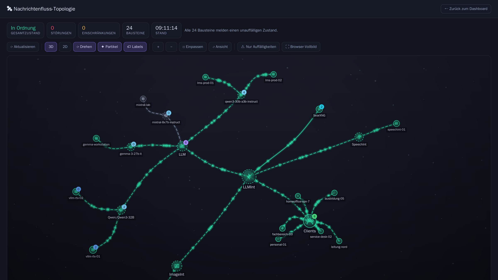

[Funktionen](#kernfunktionen) · [In Aktion](#llmint-in-aktion) · [Schnellstart](#schnellstart-mit-docker) · [Dokumentation](#weiterführende-dokumentation) · [API](#api)

## Warum LLMInt?

In vielen Organisationen laufen mehrere KI-Systeme nebeneinander – und mit ihnen die Fragen: Welches Modell passt für diese Aufgabe? Welcher Server hat gerade Kapazität? Wo liegen die Antworten aus den internen Dokumenten? Wer darf was nutzen, und wohin gehen die Daten?

LLMInt beantwortet diese Fragen zentral statt pro Nutzer:

| Problem | LLMInt |
|---|---|
| Nutzer wissen nicht, welches Modell sie wählen sollen | Ein Entscheidungsmodell klassifiziert die Anfrage und Routing-Regeln ordnen sie einem Zielmodell zu – ohne Zutun des Nutzers |
| Ein einzelner Server wird zum Flaschenhals oder Single Point of Failure | Der Balancer verteilt Anfragen auf alle gesunden Endpunkte einer Modellgruppe, mit Circuit Breaker, Retry und Fallback-Ketten |
| Wissen liegt verteilt in Dokumenten, Wikis und Köpfen | Dokument-RAG und eine zentrale Vektordatenbank liefern Kontext direkt in die Antwort |
| Toolwechsel für Recherche und Bilder kostet Zeit | Websuche, Seitenabruf, Dokumentabfrage und Bildgenerierung laufen als Werkzeuge des Chat-Modells |
| Externe KI-Dienste sind datenschutzrechtlich und operativ heikel | Alle Modelle und Endpunkte laufen intern; der Betrieb bleibt unter eigener Kontrolle |

**Für wen:** IT- und Plattform-Teams, die mehr als einen LLM-Server betreiben und ihn gemeinsam nutzbar machen wollen – von Bildungseinrichtungen und KMU über Forschungs- und Innovationsteams bis zu Organisationen mit strengen Datenschutzanforderungen. Eine nicht-technische Erläuterung für Entscheider und Fachbereiche steht in [`Demo.md`](Demo.md).

## Kernfunktionen

**Automatisches Modellrouting – die Anfrage landet dort, wo sie hingehört.**
Ein konfigurierbares Entscheidungsmodell ordnet die letzte Nutzernachricht einer Kategorie zu (etwa Programmierung, Mathematik oder Bildanalyse); eine Routing-Regel bildet sie auf ein Zielmodell ab. Kategorien, Prioritäten und Zuordnungen werden im Adminbereich gepflegt, ohne Codeänderung. Ist das Entscheidungsmodell ausgelastet oder uneindeutig, bleibt es einfach beim gewählten Modell – es entsteht kein Fehler.

**Lastverteilung mit echter Ausfallsicherheit – gleichmäßig, auch wenn ein Server wegbricht.**
Der Balancer wählt unter gesunden Endpunkten einer Modellgruppe den am wenigsten ausgelasteten; bei Gleichstand entscheidet ein Fair-Share-Fenster und als Tie-Breaker Round-Robin. Fällt ein Endpunkt aus, öffnet ein Circuit Breaker, Retries laufen mit exponentiellem Backoff, und bei fehlender Kapazität greifen konfigurierte Fallback-Modelle der Reihe nach. Slots werden atomar reserviert, verwaiste Tasks automatisch beendet.

**Dokumentwissen und zentrale Wissensdatenbank – Antworten mit Kontext.**
Eigene Dateien lassen sich im Chat hochladen und werden über eine Hybrid-Suche aus BM25-Treffern, Embedding-Ähnlichkeit, Reciprocal Rank Fusion und optionalem Reranking ausgewertet. Teamweites Wissen kommt aus einer zentralen Milvus-Vektordatenbank, die LLMInt bei jeder Anfrage abfragt – über die REST-API von [docvecwizard](https://github.com/dareinelt/docvecwizard) oder über einen Import in die mitlaufende Milvus-Instanz.

**Werkzeuge direkt im Chat – recherchieren, nachlesen, Bilder erzeugen.**
Das Chat-Modell kann im Web suchen (`search_web`), ganze Seiten nachladen (`web_fetch`), das Dokumentwissen abfragen (`query_documents`) und Bilder generieren (`generate_image`). Werkzeuge werden nur an Endpunkte geschickt, die als Tool-Calling-fähig markiert sind. Fehlt ein Dienst, bleibt der Chat vollständig nutzbar – dann fehlt nur dieses Angebot.

**Diktat statt Tippen – sprechen und weiterarbeiten.**
Ein Mikrofon-Button im Eingabefeld nimmt Sprache auf, ein [SpeechInt](https://github.com/dareinelt/SpeechInt)-Dienst transkribiert sie mit whisper.cpp und formuliert die Fragmente mit einem kleinen Qwen-Modell aus. Gesprochene Befehle wie „Punkt", „Neue Zeile" oder „Lösche letztes Wort" werden in Zeichen und Formatierung umgewandelt.

**OpenAI-kompatible API – bestehende Anwendungen andocken ohne Umbau.**
Externe Applikationen nutzen LLMInt als Reverse-Proxy unter `/api/openai/v1` (wahlweise mit Tools unter `/api/openai-tools/v1`). Sie verhalten sich wie nicht angemeldete Benutzer, durchlaufen aber Prompt Security, Routing, Balancer und Fallback genau wie ein direkter Zugriff; Aufrufe werden je API-Key gezählt und protokolliert.

**Betrieb im Blick – ein Dashboard für die ganze Landschaft.**
Das Admin-Dashboard zeigt LLMInt, Modellgruppen, Endpunkte, SpeechInt, ImageInt, SearXNG, Wissensdatenbank, Clients und API als animierte Nachrichtenflow-Topologie mit Endpunktlast, Zustand, Tokenverbrauch, aktiven Clients, Aufrufen je API-Schlüssel, Such- und Generierungsjobs sowie optionalen SSH-Systemmetriken. Ein Klick auf einen Baustein öffnet seine Detailkarte mit Modell, Auslastung, Slots und Systemwerten und hebt den Weg der Anfrage vom Aufrufer bis zum antwortenden Endpunkt hervor. Die Ansicht lässt sich per **⛶ Vollbild** auf die volle Browserfenstergröße vergrößern (kein Browser-Vollbild, Beenden per Button oder Esc).

**Technische Werte der Endpunkte – direkt neben dem Routing.**
Jeder LLM-Endpunkt lässt sich mit einer [quickinfo](https://github.com/dareinelt/quickinfo)-Instanz koppeln (Server-URL und API-Schlüssel der Management-Board-API). Die Seite `admin/endpoint_tech.php` zeigt je Endpunkt in einer Zeile Modell, Ø Token/s, CPU-/GPU-Last, CPU-/GPU-Temperatur mit 24-Stunden-Minimum und -Maximum sowie RAM-/VRAM-Auslastung; ein Klick auf die Zeile öffnet quickinfo im neuen Tab. Dazu eine Nutzungsstatistik als Liniendiagramm (umschaltbar auf 3, 7, 14, 30, 90, 180 Tage oder ein Jahr) mit Clients, angemeldeten Nutzern, durchgeführten Tasks, Websuchen und fehlgeschlagenen Tasks je Tag.

**Anmeldung, wie sie zur Organisation passt.**
Lokale Konten mit Selbstregistrierung, E-Mail-Verifikation und Passwort-Reset, LDAP/Active Directory sowie optional Kerberos-basiertes Windows-SSO – direkt im Container oder über den `auth`-Container von [lanpa](https://github.com/dareinelt/lanpa).

## LLMInt in Aktion

**Der Chat.** Antworten streamen per Server-Sent Events, jede Chat-Sitzung bleibt pro Benutzer erhalten und lässt sich in der Seitenleiste wieder aufrufen. Die Antwortdetails zeigen Endpunkt, Dauer, Quellen und Kontextauslastung – nachvollziehbar, welches System geantwortet hat.

**Bilder aus einer Beschreibung.** Sagen Sie dem Modell, was Sie sehen wollen – es ruft `generate_image` auf. Weil eine CPU-Generierung Minuten dauert, kann man sich per E-Mail benachrichtigen lassen; die Mail verschickt ein Worker, damit sie auch bei geschlossenem Browser ankommt.

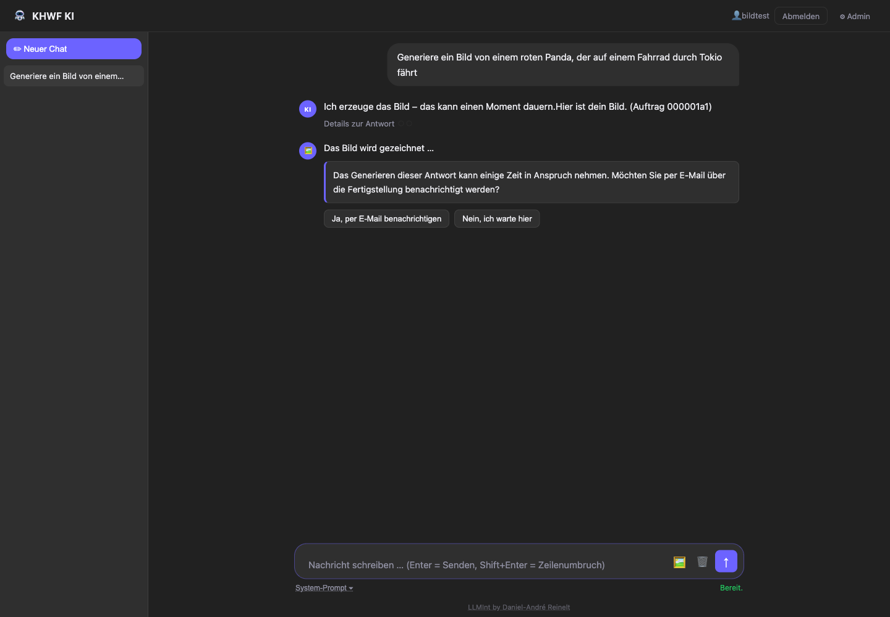

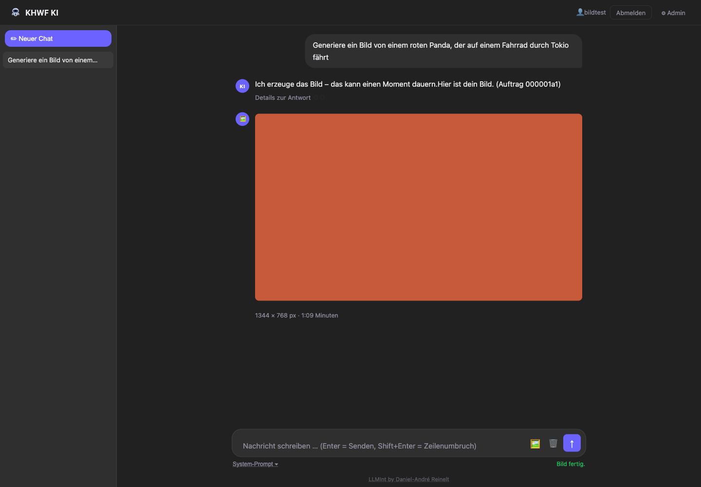

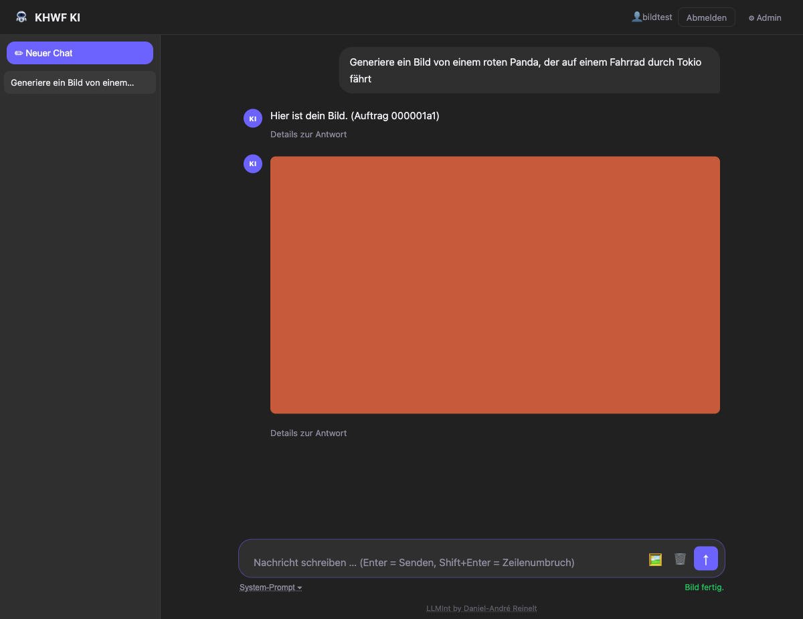

**Diktieren.** Der Mikrofon-Button erscheint, sobald die Spracherkennung aktiviert ist; erkannte Fragmente landen direkt im Eingabefeld.

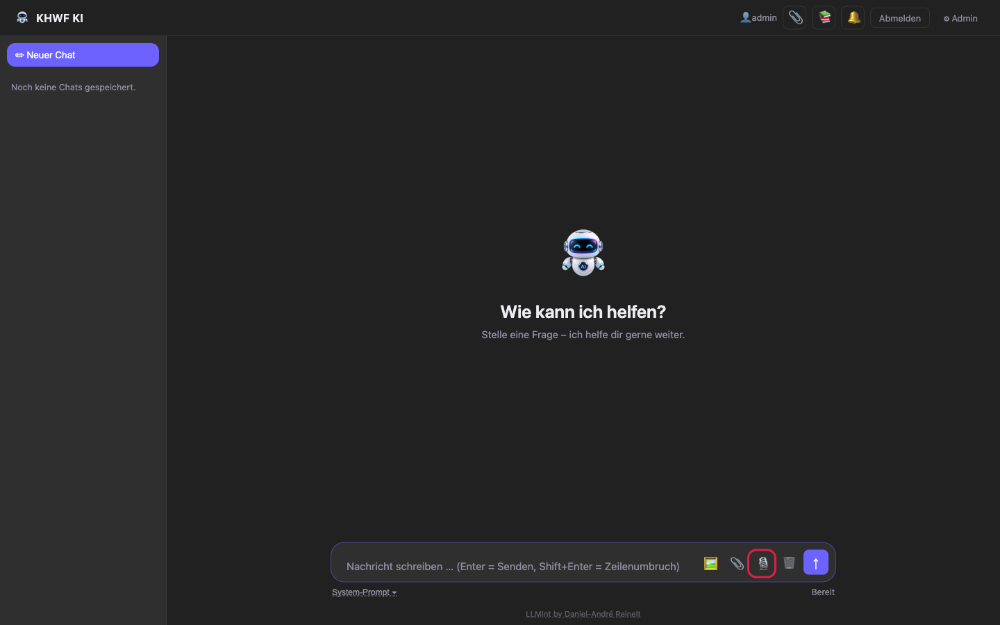

**Betreiben.** Das Dashboard macht die Landschaft und ihren Zustand auf einen Blick sichtbar.

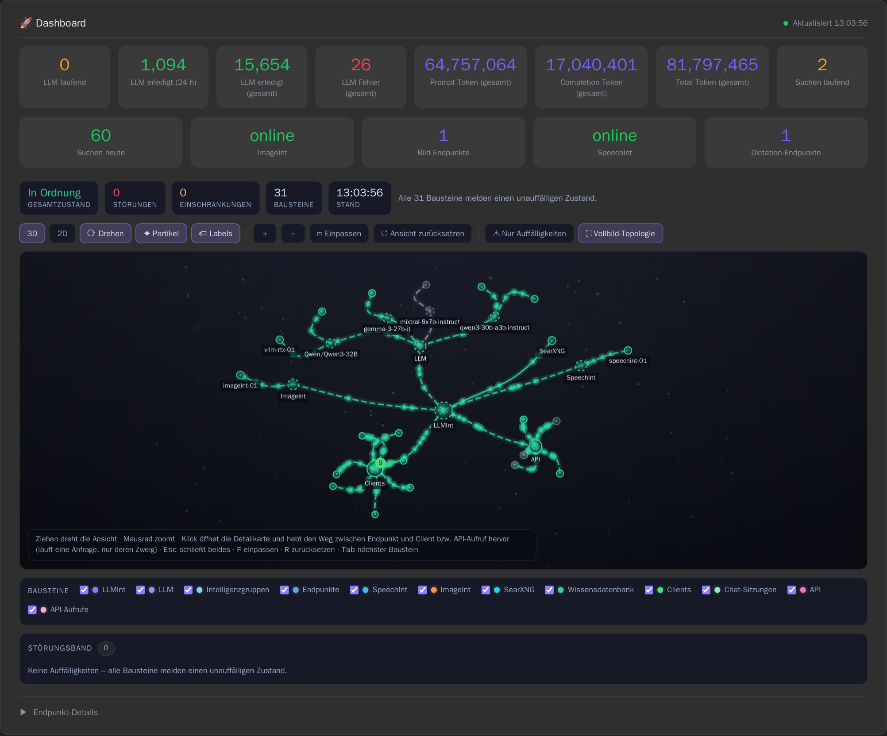

Aufbau, Knoten, Wege, Farben und Layout der Topologie beschreibt [`topologie-referenz.md`](topologie-referenz.md).

## Mehr Kontrolle direkt in der Eingabezeile

Drei Präfixe erlauben es, die Automatik für einen einzelnen Prompt zu übersteuern. Jedes erkannte Präfix wird sofort durch eine Pille ersetzt, die sich mit `×` wieder entfernen lässt.

| Präfix | Wirkung |
|---|---|
| `@@35b` | Spricht eine Intelligenzgruppe (Gesamtparameterzahl im Modellnamen) direkt an und überschreibt Benutzer-, Standard- und Routing-Modell für die aktuelle Chat-Sitzung. Ohne passendes Modell auf einem aktiven Endpunkt wird die Anfrage mit einem Hinweis auf die verfügbaren Gruppen abgewiesen. Abschaltbar unter **Anfragenhandling → Direkte Modellwahl über Intelligenzgruppen aktivieren** (Standard: aktiviert). |
| `!!` | Schaltet Thinking/Reasoning für genau diesen Prompt ein (Anzeige als 💡-Pille). Standardmäßig ist Reasoning aus: `reasoning_effort` wird nicht übertragen, hybride Chat-Templates erhalten `chat_template_kwargs.enable_thinking = false`, und gelieferte Reasoning-Tokens werden nicht angezeigt. |
| `/kommando` | Aktiviert eine feste Systemprompt-Ergänzung für diesen Prompt. Mehrere Präfixe lassen sich kombinieren, z. B. `/tldr /list Fasse den Text zusammen.` |

Nach dem Absenden werden `!!` und alle `/kommando`-Präfixe automatisch zurückgesetzt; die Präfixe selbst erreichen das Modell nie.

```text
@@35b Fasse den Text zusammen.      → immer die 35B-Intelligenzgruppe
!! Wie viele Möglichkeiten gibt es? → Reasoning nur für diese eine Frage
/tldr /list Was steht in der Datei? → Kurzfassung als Aufzählung
```

<details>
<summary><strong>Alle verfügbaren <code>/kommando</code>-Funktionen</strong></summary>

| Präfix | Wirkung |
| --- | --- |
| `/table` | Antwort ausschließlich als Markdown-Tabelle. |
| `/outline` | Übersichtliche, hierarchische Gliederung bzw. Inhaltsverzeichnis. |
| `/list` | Antwort als Aufzählung (Bullet Points). |
| `/checklist` | Umsetzbare To-do-Liste mit Checkboxen. |
| `/steps` | Chronologische Schritt-für-Schritt-Anleitung. |
| `/code` | Antwort ausschließlich als Code-Block. |
| `/json` | Antwort strikt als valides JSON. |
| `/tldr` | Ultrakurze Zusammenfassung in 2–3 Sätzen. |
| `/summary` | Klassische, ausgewogene Zusammenfassung. |
| `/short` (oder `/brief`) | Extrem prägnante Antwort ohne Floskeln. |
| `/expand` | Baut kurze Notizen zu einem detaillierten Text aus. |
| `/eli5` | Erklärung mit einfachen Analogien wie für ein Kind. |
| `/deep` (oder `/adv`) | Akademisches Niveau mit tiefer wissenschaftlicher Analyse. |
| `/tech` | Rein technische Erklärung mit Fachbegriffen und Systemdetails. |
| `/examples` | Erklärung primär anhand praktischer Beispiele. |
| `/human` | Lockerer, menschlich klingender Stil ohne KI-Floskeln. |
| `/expert` (oder `/pro`) | Formeller, professioneller Stil mit Branchen-Fachjargon. |
| `/casual` | Freundlicher, entspannter Ton für Social Media/Chat. |
| `/rewrite` | Formuliert einen bereitgestellten Text stilistisch um. |
| `/proscons` | Analyse der Vor- und Nachteile einer Idee oder Entscheidung. |
| `/brainstorm` | Liste kreativer, unkonventioneller Ideen. |
| `/factcheck` | Prüft eine Behauptung im Text auf ihren Wahrheitsgehalt. |
| `/critic` | Sucht gezielt nach Schwachstellen und logischen Fehlern in einer Argumentation. |

</details>

## Schnellstart mit Docker

1. Konfiguration anlegen:

   ```bash
   cp .env.example .env
   ```

2. In `.env` mindestens die Standardpasswörter ändern:

   ```dotenv
   DB_NAME=llmint
   DB_USER=llmint
   DB_PASS=ein-starkes-datenbankpasswort
   DB_ROOT_PASS=ein-starkes-rootpasswort
   HTTP_PORT=8080
   PMA_PORT=8081
   PMA_BASIC_AUTH_USER=admin
   PMA_BASIC_AUTH_PASSWORD=ein-starkes-passwort
   TZ=Europe/Berlin
   ```

3. Container bauen und starten:

   ```bash
   docker compose up -d --build
   ```

   Der Web-Container wartet auf MySQL und führt anschließend `setup.php` aus. Das Setup ist idempotent und kann deshalb bei Containerstarts erneut laufen. Bei leerer Datenbank entsteht der Benutzer `admin` mit dem Passwort `admin` – sofort ändern.

4. Anwendung öffnen:

   | Dienst | Adresse |
   |---|---|
   | Chat | `http://localhost:8080` |
   | Administration | `http://localhost:8080/admin/login.php` |
   | phpMyAdmin | `http://localhost:8081` |

   phpMyAdmin ist zusätzlich durch HTTP Basic Auth geschützt. Danach ist weiterhin die Datenbankanmeldung erforderlich.

Persistente Docker-Volumes:

- `db_data` für die Datenbank
- `doc_uploads` für hochgeladene Dokumente
- `sd_output` für generierte Bilder der früheren AUTOMATIC1111-Integration (Bestand)
- `image_output` für generierte Bilder der ImageInt-Integration
- `docconvert_cache` für den Konvertierungs-Cache
- `milvus_data` für die lokale Milvus-Vektordatenbank (Modus `local` der Wissensdatenbank)
- `vector_imports` für docvecwizard-Exportarchive, die serverseitig importiert werden sollen

Der `milvus`-Service (Standalone mit eingebettetem etcd, ca. 2 GB RAM) wird nur im Modus `local` der Wissensdatenbank benötigt. Wer ausschließlich die docvecwizard-API nutzt, kann ihn mit `docker compose stop milvus` anhalten.

Die rechenintensiven Diktat-Modelle (whisper.cpp und Qwen3.5-2B) laufen **nicht** in diesem Stack, sondern im separaten Projekt [SpeechInt](https://github.com/dareinelt/SpeechInt) auf einem eigenen Docker-Host. LLMInt spricht ihn über HTTP an; ist kein SpeechInt-Endpunkt konfiguriert oder erreichbar, bleibt der Chat vollständig nutzbar, das Diktat ist dann deaktiviert. Details und die Mindestanforderung an den SpeechInt-Host stehen unter [Spracherkennung und Diktat](#spracherkennung-und-diktat).

Häufige Befehle:

```bash
docker compose logs -f web
docker compose restart web
docker compose down
docker compose down -v # entfernt auch Volumes und damit Daten
```

## Klassische Installation

1. Repository klonen und eine Datenbank anlegen:

   ```bash
   git clone https://github.com/dareinelt/LLMInt.git
   cd LLMInt
   ```

   ```sql
   CREATE DATABASE llmint CHARACTER SET utf8mb4 COLLATE utf8mb4_unicode_ci;
   ```

2. Datenbankverbindung als Umgebungsvariablen setzen:

   ```bash
   export DB_HOST=127.0.0.1
   export DB_PORT=3306
   export DB_NAME=llmint
   export DB_USER=llmint
   export DB_PASS='ein-starkes-passwort'
   ```

   Ohne Variablen verwendet die Anwendung `localhost`, Port `3306`, Datenbank `llmint`, Benutzer `root` und ein leeres Passwort.

3. Initialisieren:

   ```bash
   php setup.php
   ```

   Bei einer leeren Datenbank wird der Benutzer `admin` mit dem Passwort `admin` angelegt. Das Passwort sofort ändern und `setup.php` nach der Einrichtung absichern oder entfernen.

## Erstkonfiguration

Nach der Anmeldung unter `/admin/login.php`:

1. Passwort des Administrators ändern.
2. Mindestens einen LLM-Endpunkt mit Basis-URL, Timeout und `default_model` anlegen.
3. Das globale Standardmodell konfigurieren.
4. Optional Routing, Vision-Modell, SearXNG, SMTP und LDAP einrichten.
5. Optional Endpunkte für ImageInt und Embeddings hinzufügen.
6. Optional Hybrid-Suche, Reranker und Prompt Security aktivieren.
7. Verbindungs- und Funktionstests im Admin-Bereich ausführen.

Endpunkte mit demselben `default_model` bilden einen Pool. Das Routing kann eine Nutzeranfrage zuerst einer Kategorie zuordnen und diese über `routing_rules` auf ein Zielmodell abbilden. Ist die Klassifikation nicht verfügbar, wird die ursprüngliche Modellauswahl verwendet. Unter **Balancer & Routing** lassen sich außerdem Kapazitätsgrenzen, Circuit Breaker, Retry-Verhalten und Fallback-Ketten konfigurieren.

## Voraussetzungen

| Komponente | Erforderlich für |
|---|---|
| PHP 8.0+ mit `curl`, `pdo_mysql`, `mbstring` und `fileinfo` | klassische Installation |
| MySQL oder MariaDB mit `utf8mb4` | Persistenz |
| OpenAI-/LM-Studio-kompatibler Chat-Endpunkt | Chat |
| Docker und Docker Compose | Docker-Installation |
| `pdftotext` (Poppler) | PDF-Extraktion für RAG |
| Embedding-Endpunkt | semantische Suche |
| SearXNG, ImageInt, LDAP, SMTP | jeweilige optionale Integration |

Das Docker-Image enthält zusätzlich LDAP-, XML-, ZIP- und Internationalisierungs-Unterstützung sowie Poppler und Kerberos/GSSAPI-Komponenten.

## Anwendungsfälle

- **Wissensarbeit und Fachabteilungen:** interne Leitlinien, Protokolle und Dokumentationen direkt im Chat abfragen – die Antwort kommt mit Quellen aus der eigenen Wissensdatenbank.
- **Programmierung und IT-Support:** Code-Fragen landen automatisch beim spezialisierten Coding-Modell.
- **Recherche und Aufbereitung:** aktuelle Informationen per Websuche einbinden und strukturiert zusammenfassen.
- **Bildanalyse und Visualisierung:** Diagramme, Fotos oder Screenshots im Chat beschreiben lassen – das Vision-Modell wird automatisch gewählt.
- **Kreativ- und Kommunikationsaufgaben:** Bildideen per Text erzeugen und direkt weiterverwenden.
- **KI-Betrieb im Team:** mehrere KI-Server gemeinsam nutzen statt Inseln zu betreiben, mit zentraler Steuerung, wer was nutzen darf.

## Weiterführende Dokumentation

| Dokument | Zielgruppe |
|---|---|
| [`README.md`](README.md) | Betrieb, Installation, Konfiguration und Funktionsüberblick |
| [`Demo.md`](Demo.md) | nicht-technische Erklärung für Entscheider und Fachbereiche |
| [`description.md`](description.md) | detaillierte Architektur- und Funktionsreferenz für Entwicklung und Coding-Agenten |
| [`docs/architecture.md`](docs/architecture.md) | Systemarchitektur, Datenflüsse und Diagramme (ergänzt `description.md`) |
| [`docs/functions.md`](docs/functions.md) | vollständige Funktionsreferenz je Datei |
| [`docs/agent_index.md`](docs/agent_index.md) | kompakte Navigationshilfe für Coding-Agenten |
| [`topologie-referenz.md`](topologie-referenz.md) | Aufbau, Funktionsweise und Anpassung der Dashboard-Topologie |
| [`tests/README.md`](tests/README.md) | Aufbau und Ausführung der Test-Suiten |

## Technische Referenz

### Architektur

| Ebene | Komponenten |
|---|---|
| Web | `index.php`, Anmeldung und Registrierung |
| API | `api/chat.php`, Routing, RAG, Uploads, Bildgenerierung und OpenAI-Endpunkte |
| Administration | `admin/` für Endpunkte, Benutzer, Einstellungen, API-Keys und Statistik |
| Persistenz | MySQL oder MariaDB; das Schema wird idempotent durch `setup.php` und `db.php` erweitert |
| Externe Dienste | OpenAI-kompatible LLM-/Embedding-Endpunkte, optional SearXNG, LDAP, SMTP; für das Diktat ein oder mehrere [SpeechInt](https://github.com/dareinelt/SpeechInt)-Dienste (whisper.cpp + Qwen3.5-2B) und für die Bildgenerierung ein oder mehrere [ImageInt](https://github.com/dareinelt/ImageInt)-Dienste (Qwen-Image-2.1), die jeweils auf einem separaten Docker-Host laufen |

Wichtige Komponenten:

- `api/balancer.php` wählt LLM-Endpunkte und erfasst deren Task-Lifecycle.
- `lib/balancer_engine.php` bündelt Circuit Breaker, Backoff, Fallback-Ketten, verwaiste Tasks und die konfigurierbaren Balancer-Einstellungen.
- `api/embedding.php` erstellt Embeddings, führt Ähnlichkeitssuche und optionales Reranking aus.
- `api/upload_document.php` verarbeitet Uploads und legt Dokument-Chunks an; `api/doc_convert.php`, `api/pdf_render.php` und `api/vision.php` kapseln Konverter-Dienst, PDF-Rendering und Vision-Analyse.
- `lib/prompt_security.php` prüft Chat-Anfragen vor der Weiterleitung an das LLM.
- `lib/speech_dictation.php` kapselt das Diktat als HTTP-Client eines SpeechInt-Dienstes: Transkription, Nachbearbeitung, Diktatbefehle und Befehls-Pillen, Prompt für das Diktat-Modell, Health-/Konfigurationsabfragen und der deterministische Regel-Fallback, wenn kein Dienst erreichbar ist.
- `setup.php` richtet die initialen Tabellen ein und erstellt bei einer leeren Datenbank den Standardadministrator.

Es gibt bewusst kein Framework, keinen Router, keinen Paketmanager und keinen Build-Schritt: Jede URL entspricht einer PHP-Datei, Abhängigkeiten werden über `require_once` geladen, und Frontend-CSS/-JavaScript liegen inline in `index.php` beziehungsweise in den Adminseiten unter `admin/` (gemeinsame Hülle: `admin/partials/`).

### Repository-Struktur

| Pfad | Inhalt |
|---|---|
| `index.php` | Chat-Oberfläche mit Streaming, Sitzungsliste, Upload-Dialog und Bildanhängen |
| `login.php`, `register.php`, `logout.php` | Anmeldung, Selbstregistrierung mit E-Mail-Verifikation, Abmeldung |
| `sso.php`, `sso_fallback.php` | Windows-SSO über den Reverse-Proxy von lanpa und Rückfallseite ohne Domänenanmeldung |
| `db.php` | Datenbankverbindung, idempotentes Laufzeitschema, Einstellungen, Logging, Chat-Sitzungen, Intelligenzgruppen |
| `config.php` | leitet `LMSTUDIO_BASE_URL` und `LMSTUDIO_TIMEOUT` aus Endpunkten beziehungsweise Einstellungen ab |
| `setup.php` | Erstinstallation: Tabellen, Migrationen, Standardeinstellungen, Standardadministrator |
| `api/` | JSON- und SSE-Endpunkte sowie die Bibliotheken für Balancer und Embeddings |
| `lib/` | Balancer-Engine, Prompt Security, Spracherkennung/Diktat (`speech_dictation.php`), OpenAI-Hilfsfunktionen, LDAP-Anbindung, SMTP-Client, Routing-Prompt, Reverse-Proxy-Unterstützung |
| `admin/` | Administration als eine Seite je Navigationseintrag (`admin/<seite>.php`, z. B. `index.php`, `usage.php`, `smtp.php`, `api_keys.php`) über der gemeinsamen Hülle `admin/partials/` (Bootstrap, POST-Verarbeitung, Livedaten, Navigation, Layout); dazu Dashboard-Livedaten, Nutzungsstatistik, SSH-Systemmetriken, Prompt Security |
| `docker/`, `Dockerfile`, `docker-compose.yml` | Container-Setup inklusive phpMyAdmin mit HTTP Basic Auth |
| `docker-compose.test.yml` | Compose-Override für einen schnellen lokalen Stack beim Testen des Diktats (siehe [Spracherkennung und Diktat](#spracherkennung-und-diktat)) |
| `docker-compose.lanpa.yml` | optionaler Override für den Betrieb hinter dem `auth`-Container von lanpa |
| `tests/` | abhängigkeitsfreie PHP- und JavaScript-Tests für Topologie und Canvas-Renderer (siehe [`tests/README.md`](tests/README.md)) |
| `docconvert/` | Python/FastAPI-Container zur Konvertierung von Office- und Textdateien in strukturierte Chunks |
| `doc_uploads/`, `sd_output/`, `image_output/` | Laufzeitdaten für hochgeladene Dokumente und generierte Bilder |
| `assets/`, `docs/`, `ressources/` | Bilder der Oberfläche, Diagramme der Dokumentation, Beispiel-Systemprompt |

### Admin-Dashboard

Der Adminbereich ist in eine Seite je Eintrag der linken Navigation aufgeteilt: `admin/index.php` ist das Dashboard, daneben gibt es eigene Seiten für Nutzungsstatistik (`admin/usage.php`), Endpunkte (`admin/endpoints.php`), die technische Endpunktverwaltung (`admin/endpoint_tech.php`), SMTP (`admin/smtp.php`) und alle weiteren Einträge. Die Knoten der Topologie verlinken direkt auf die Seite mit der passenden Karte. In der Detailkarte eines Endpunkts stehen Modell, Status, belegte Slots, laufende Tasks und – sofern eine [quickinfo](https://github.com/dareinelt/quickinfo)-Instanz gekoppelt ist – CPU-/GPU-Werte; die übrigen Dienste zeigen ihre Erreichbarkeit.

Erklärungen, die nicht zur unmittelbaren Bedienung nötig sind, stehen auf jeder Seite hinter einem **?**-Symbol neben der Karte oder dem Feld. Der Klick öffnet ein Overlay mit allen Beschreibungen dieser Karte; die Oberfläche selbst bleibt auf Beschriftungen, Felder und Zustandsmeldungen beschränkt. Die Texte registriert jede Seite mit `admin_help_text()`, den Knopf setzt `admin_help_button()`, das Overlay rendert `admin_help_overlay()` aus `admin/partials/help.php` einmal je Seite.

Die Topologie zeigt **LLMInt** im Zentrum; darum liegen die direkten Kinder **LLM**, **SpeechInt**, **ImageInt**, **SearXNG**, **Wissensdatenbank**, **Clients** und **API**. Unter LLM hängen die Intelligenzgruppen (je Modell), unter diesen die einzelnen LLM-Endpunkte; ImageInt und SpeechInt bündeln ihre Endpunkte jeweils direkt. Aktive Clients erscheinen als 3D-Wolke aus Hostnamen beziehungsweise IP-Adressen um ihren Knoten, die Aufrufe über die OpenAI-kompatible API als zweite Wolke (ein Eintrag je API-Schlüssel mit Aufrufen heute, Aufrufen gesamt und zuletzt genutztem Modell, dazu ein Sammeleintrag „ohne Key"). Animierte Linien und Partikel machen Richtung und Auslastung sichtbar; Farbe und Strichart folgen dem Knotenzustand (in Ordnung, eingeschränkt, Störung, nicht aktiv).

Ein Klick auf einen Endpunkt öffnet seine Detailkarte direkt im Netz und hebt gleichzeitig den kompletten Weg dieses Bausteins hervor: vom Endpunkt über seine Intelligenzgruppe und LLM hinauf zu LLMInt und von dort in die Zweige der Aufrufer – bis zu einzelnen Client-Hostnamen beziehungsweise API-Schlüsseln. Umgekehrt markiert ein Klick auf einen Aufrufer den Weg von dort bis hinunter in die Endpunkt-Zweige. Läuft auf einem Client gerade eine Anfrage, bleibt der Weg auf genau deren Zweig beschränkt und wird als laufender Weg mit wanderndem Strichmuster gekennzeichnet; ist der Client untätig, wird kein Weg markiert. Welche Anfrage läuft, meldet der Browser im Heartbeat mit (Endpunktart, Modell, Endpunkt-ID), der Adminbereich zeigt sie als Zeile „Laufende Anfrage" am Client-Knoten und nach spätestens 15 s auch in der Topologie. Gruppen, die beiden Wolken und Übersichtsknoten öffnen stattdessen das ausführliche Panel am Rand mit Mitglieder- und Nachbarlisten. Die Ansicht lässt sich per **⛶ Vollbild** auf die volle Browserfenstergröße vergrößern (kein Browser-Vollbild, Beenden per Button oder Esc).

### Modellrouting und Entscheidungsfindung

Das Routing arbeitet in zwei Stufen: Zuerst bestimmt LLMInt die passende Modellgruppe, danach wählt der Balancer innerhalb dieser Gruppe einen geeigneten Endpunkt. Ist ein Entscheidungsmodell konfiguriert, bewertet es die letzte Nutzernachricht anhand der konfigurierten Kategorien und priorisierten Entscheidungsregeln. Eine Routing-Regel ordnet die erkannte Kategorie einem Zielmodell zu. Fehlt eine Zuordnung, ist das Entscheidungsmodell nicht verfügbar oder kann keine Nachricht klassifiziert werden, bleibt die ursprünglich angeforderte Modellauswahl erhalten.

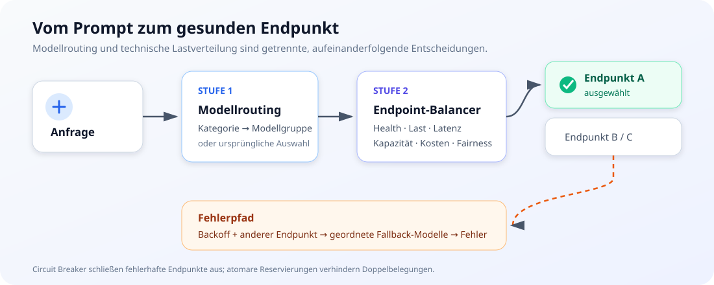

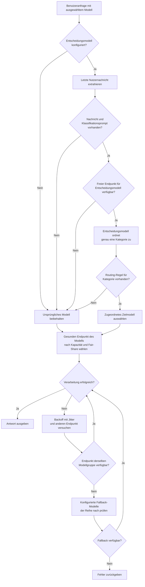

**Vorteile**

- **Passende Modellwahl:** Fachliche, kreative oder allgemeine Anfragen können an jeweils geeignete Modellgruppen geleitet werden.
- **Effizienter Ressourceneinsatz:** Leistungsfähige oder spezialisierte Modelle werden gezielt genutzt, statt jede Anfrage gleich zu behandeln.
- **Konfigurierbare Entscheidungen:** Kategorien, Prioritäten und Modellzuordnungen werden im Admin-Bereich gepflegt und lassen sich ohne Codeänderung anpassen.
- **Robuster Betrieb:** Bei fehlender Klassifikation oder Kapazität wird die Benutzeranfrage weiterhin mit dem ursprünglich gewählten Modell verarbeitet.
- **Geordnete Fallbacks:** Schlägt ein Endpunkt fehl und ist kein weiterer Endpunkt derselben Modellgruppe frei, werden konfigurierte Ersatzmodelle in der vorgegebenen Reihenfolge geprüft.
- **Fähigkeits- und Spezialisierungsdaten:** Endpunkte können für Tool Calling und Kategorien gekennzeichnet werden; Upgrade-Vorschläge berücksichtigen die fachliche Spezialisierung.
- **Faire Auslastung:** Nach der Modellentscheidung verteilt der Balancer Anfragen auf freie, gesunde Endpunkte und bevorzugt bei Gleichstand lange nicht genutzte Endpunkte.

### Intelligence Upgrade

Das Intelligence Upgrade verbindet angemessenen Ressourceneinsatz mit der Möglichkeit, bei anspruchsvolleren Aufgaben mehr Modellleistung zu nutzen. Eine Anfrage wird zunächst mit dem ausgewählten Modell beantwortet. Ist ein leistungsfähigeres Modell mit freier Kapazität verfügbar, erhält der Benutzer anschließend ein optionales Upgrade-Angebot. Nach Zustimmung wird dieselbe Anfrage mit dem vorgeschlagenen Modell erneut ausgeführt; die Auswahl gilt anschließend 20 Minuten lang für die aktuelle Chat-Sitzung.

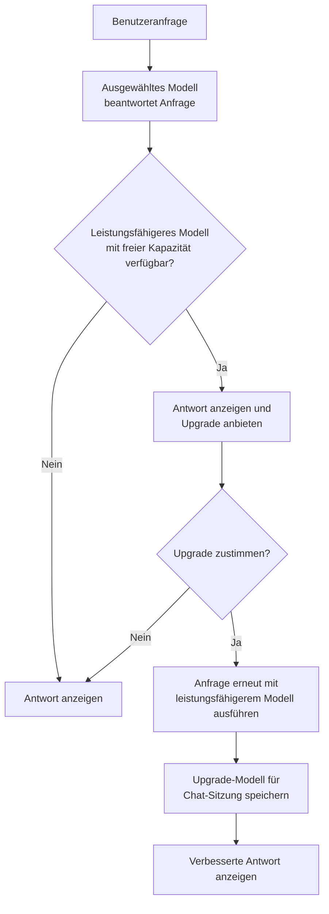

**Vorteile**

- **Ressourcenschonend:** Für einfache Fragen reicht ein kleines Modell; leistungsfähige Modelle bleiben für komplexe Aufgaben verfügbar.
- **Bessere Antwortqualität bei Bedarf:** Benutzer können bei anspruchsvollen Fragen gezielt eine erneute Bearbeitung mit höherer Modellintelligenz anfordern.
- **Transparente Entscheidung:** Das Upgrade erfolgt nur nach Zustimmung und nur, wenn ein geeigneter Endpunkt Kapazität hat.
- **Passende Spezialisierung:** Bei erkannter Kategorie werden nur allgemeine oder passende Modelle vorgeschlagen.

Damit ein Modell berücksichtigt wird, muss seine Modellbezeichnung eine Intelligenzstufe wie `8b` oder `70b` enthalten, beispielsweise `modell-8b` oder `modell 70b`. In der Administration kann bei **Systemmeldungen** der Text des Upgrade-Angebots angepasst werden.

### Lastverteilung

Die Endpunktauswahl für LLM-Anfragen läuft über die gemeinsame Engine aus `lib/balancer_engine.php`; die Tabellen der früheren AUTOMATIC1111-/ComfyUI-Integrationen kennt sie nur noch lesend. Die maximale Anzahl paralleler Tasks je Endpunkt ist über `balancer_max_concurrent` konfigurierbar und beträgt standardmäßig vier.

Die Auswahl erfolgt in einer festen Prioritätsfolge:

1. Nur aktive Endpunkte der benötigten Modellgruppe beziehungsweise Bild-Engine werden berücksichtigt.
2. Endpunkte mit offenem Circuit Breaker oder ohne freien Task-Slot werden ausgeschlossen.
3. Die laufenden Tasks je Endpunkt werden verglichen; weniger ausgelastete Endpunkte werden bevorzugt.
4. Bei gleicher Auslastung entscheidet der Fair-Share: Der Endpunkt mit den wenigsten Zuweisungen innerhalb des Fairness-Fensters (`balancer_fairness_window_seconds`, Standard 15 Minuten) erhält die Aufgabe.
5. Bei Gleichstand entsteht durch die älteste letzte Zuweisung ein Round-Robin-Effekt; noch nie verwendete Endpunkte kommen zuerst.

Die gemessene Latenz fließt bewusst **nicht** in die Auswahl ein: Alle Endpunkte liegen im selben Subnetz, `avg_latency_ms` ist daher ein rein statistischer Wert für Monitoring und Admin-Ansicht.

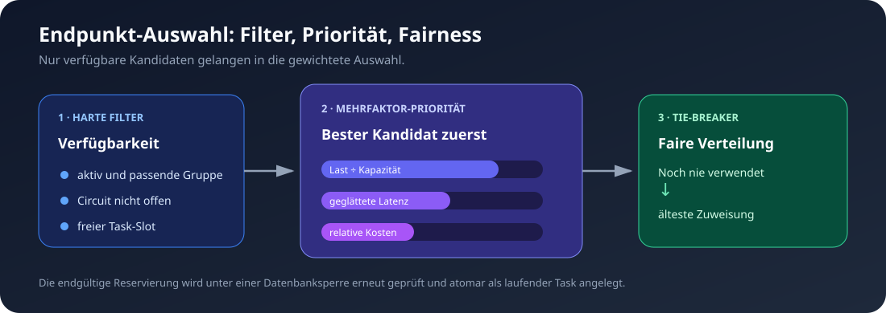

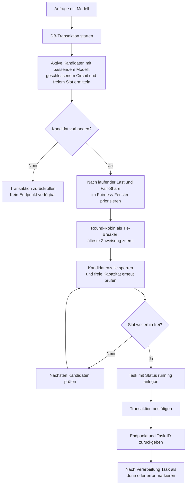

#### Ausfallsicherheit

- **Circuit Breaker:** Nach standardmäßig drei aufeinanderfolgenden Fehlern wird ein Endpunkt für 30 Sekunden aus dem Routing genommen. Danach prüft eine einzelne Half-Open-Anfrage die Erholung. Erfolg schließt den Circuit, ein weiterer Fehler öffnet ihn erneut. In den Endpunkt-Details des Dashboards lässt sich der Circuit Breaker über die Schaltfläche **♻ Circuit zurücksetzen** manuell schließen, ohne den Cooldown abzuwarten.
- **Endpunkt pausieren:** In den Endpunkt-Details des Dashboards lässt sich ein Endpunkt über die Schaltfläche **⏸ Pausieren** aus dem Routing nehmen; laufende Aufgaben bleiben davon unberührt. **▶ Fortsetzen** gibt ihn wieder frei und setzt dabei den Circuit Breaker zurück.
- **Retry und Backoff:** Ein fehlgeschlagener LLM-Aufruf kann auf bis zu zwei weiteren Endpunkten wiederholt werden. Exponentielles Backoff mit optionalem Full Jitter verhindert gleichzeitige Retry-Spitzen.
- **Fallback-Ketten:** Ist beim Retry kein Endpunkt derselben Modellgruppe verfügbar, prüft LLMInt die unter `balancer_fallback_chains` hinterlegten Ersatzmodelle der Reihe nach.
- **Verwaiste Tasks:** Lange im Status `running` verbliebene Tasks werden nach einem konfigurierbaren Timeout als Fehler abgeschlossen und blockieren keinen Slot dauerhaft.
- **Atomare Reservierung:** `SELECT ... FOR UPDATE` und eine erneute Kapazitätsprüfung unter der Datenbanksperre verhindern die Doppelbelegung eines Slots.

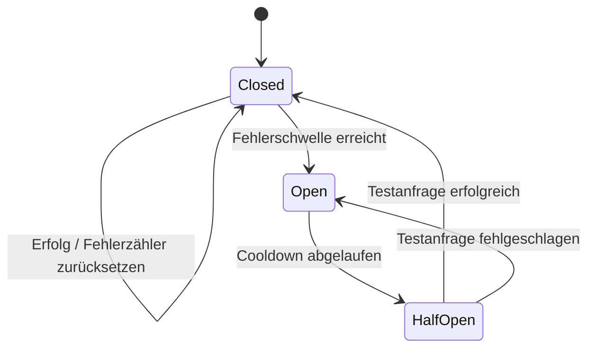

Die Parameter werden unter **Administration → Balancer & Routing** gepflegt:

| Einstellung | Standard | Zweck |
|---|---:|---|
| `balancer_max_concurrent` | `4` | parallele Tasks je Endpunkt |
| `balancer_circuit_fail_threshold` | `3` | Fehler bis zum Öffnen des Circuit Breakers |
| `balancer_circuit_cooldown_seconds` | `30` | Wartezeit bis zur Half-Open-Testanfrage |
| `balancer_backoff_base_ms` / `balancer_backoff_max_ms` | `200` / `8000` | Grenzen des exponentiellen Backoffs |
| `balancer_backoff_jitter` | aktiv | zufällige Verteilung der Retry-Verzögerung |
| `balancer_orphan_timeout_seconds` | `300` | Timeout für verwaiste Tasks |
| `balancer_fairness_window_seconds` | `900` | Zeitfenster für den Fair-Share-Vergleich je Endpunkt |
| `balancer_fallback_chains` | `{}` | geordnete Ersatzmodelle als JSON-Objekt |

### Hybrid-RAG

Dokumente werden über `api/upload_document.php` hochgeladen – entweder über den Upload-Dialog oder direkt im Chat über das Büroklammer-Symbol neben dem Bild-Upload. Unterstützt werden:

- **Office-Dokumente:** Word (`.docx`), Excel (`.xlsx`, `.xlsm`, `.xls`), PowerPoint (`.pptx`) und OpenDocument (`.odt`, `.ods`, `.odp`).
- **Textformate:** `.txt`, `.md`, `.rtf`, `.csv`, `.tsv`, `.json`, `.xml`, `.html`, `.yaml`, `.log`, `.ini`, `.conf`.
- **PDF:** Jede Seite wird mit `pdftoppm` in ein Bild umgewandelt und einzeln vom Vision-Modell gelesen, sodass auch Scans, Tabellen, Formulare und Diagramme erfasst werden. Als Rückfallweg dient die Textebene (`pdftotext`).
- **Bilder:** PNG, JPG, WEBP und GIF werden vom konfigurierten Vision-Modell beschrieben.

Office- und Textdateien konvertiert der separate Container `docconvert` (Python/FastAPI). Er liefert strukturierten Text und strukturbewusste Chunks mit Quellenangabe (Kapitel, Tabellenblatt und Zeilenbereich, Foliennummer) und hält Ergebnisse per Content-Hash in einem temporären TTL-Cache vor. Ist der Dienst nicht erreichbar, verarbeitet ein PHP-Fallback zumindest die reinen Textformate.

Im Chat hochgeladene Dateien werden an die Chat-Sitzung gebunden, als Chip über dem Eingabefeld angezeigt und bei der RAG-Suche bevorzugt. Sie werden standardmäßig **nicht** dauerhaft aufbewahrt: Die Datei wird nur im Rahmen der Chat-Sitzung verarbeitet, die hochgeladene Datei nach der Analyse vom Server gelöscht und außerhalb dieser Sitzung nicht für RAG verwendet. Ein Klick auf den Chip öffnet ein Overlay mit der standardmäßig deaktivierten Option „Diese Datei in meine Wissensdatenbank aufnehmen und für spätere Informationssuche aufbewahren" (`api/document_retention.php`). Aufbewahrte Dateien listet das Bibliotheks-Overlay (📚 im Kopfbereich) auf; dort lassen sich eigene Dateien löschen. **Alle Nutzer-Uploads sind ausschließlich privat** – eine Freigabe „für alle Nutzer" gibt es nicht mehr; gemeinsames Wissen kommt aus der zentralen Vektordatenbank (siehe unten). Uploads über den Upload-Dialog (RAG-Workflow) werden wie bisher dauerhaft (privat) gespeichert. Ein Fortschrittsbalken zeigt Upload und anschließende Verarbeitung an. Große Zwischenablage-Inhalte (mehr als 100 Zeilen) werden beim Einfügen mit Strg+V automatisch als Datei „Eingefügter Text" angehängt, damit nichts verloren geht. Datei- und Bildanhänge stehen ausschließlich angemeldeten Benutzern zur Verfügung.

Die Pipeline speichert Chunks in `document_chunks`. Bei aktivierten Embeddings wird nach dem Chunking eine OpenAI-kompatible Embedding-API aufgerufen. Die Suche kombiniert dann:

1. BM25-Keyword-Treffer
2. Cosine Similarity über gespeicherte Embeddings
3. Reciprocal Rank Fusion
4. optionales Reranking

Ist ein Embedding-Endpunkt oder Reranker nicht erreichbar, fällt die Anwendung auf die vorherige Suchstufe zurück. Relevante Einstellungen sind `embedding_enabled`, `hybrid_search_enabled`, `bm25_weight`, `embedding_weight`, `embedding_cache_enabled`, `reranker_enabled`, `reranker_endpoint` und `reranker_top_k`. Für den Upload selbst kommen `vision_model`, `pdf_vision_enabled`, `pdf_vision_dpi`, `pdf_vision_max_pages` und `upload_max_mb` hinzu.

#### Zentrale Wissensdatenbank (docvecwizard / Milvus)

Teamweites Wissen wird nicht mehr von Nutzern hochgeladen, sondern zentral mit [docvecwizard](https://github.com/dareinelt/docvecwizard) aufbereitet und in einer Milvus-Vektordatenbank gehalten. LLMInt bindet diese Wissensbasis über `api/vector_store.php` in **einem von zwei Modi** ein (Admin → „🧠 Wissensdatenbank", Einstellung `vector_store_mode`):

| Modus | Beschreibung |
|-------|--------------|
| `remote` | LLMInt meldet sich an der REST-API von docvecwizard an (`docvec_api_url`, `docvec_api_username`, `docvec_api_password`) und fragt dessen Milvus-Instanz über `POST /api/search` ab. Die Embeddings erzeugt docvecwizard selbst; LLMInt benötigt dafür keinen eigenen Embedding-Endpunkt. |
| `local` | Ein docvecwizard-**Export** (`.tar.gz` mit `manifest.json`, `checksums/SHA256SUMS`, `documents/<version>/{metadata,chunks,vectors}.json`) wird über die Admin-Oberfläche (`api/vector_import.php`) in die im Compose-Stack mitlaufende Milvus-Instanz (`milvus`-Service, Collection `docvec_<modell>`) und als Volltext nach MySQL (`vector_documents`, `vector_chunks`) importiert. Archive können per Browser hochgeladen oder in das Volume `vector_imports/` gelegt werden. Für die Suche muss ein Embedding-Endpunkt mit demselben Modell wie beim Export aktiv sein. |
| `off` | Keine zentrale Wissensdatenbank; nur private Uploads werden durchsucht. |

Ist ein Modus aktiv, zieht `api/chat.php` **bei jeder Anfrage** die `vector_top_k` besten Treffer (Mindest-Score `vector_min_score`) aus der Vektordatenbank, injiziert sie als Kontext-Systemnachricht und stellt sie zusätzlich dem Tool `query_documents` zur Verfügung. Jede Abfrage wird in `vector_query_logs` protokolliert. Status (online/offline, Dokumente, Vektoren, Abfragen heute, Ø Antwortzeit) erscheint am Knoten „Wissensdatenbank" der Dashboard-Topologie – bei `remote` mit der URL des API-Endpunkts, bei `local` mit der Milvus-URL. Beide Modi lassen sich in der Admin-Oberfläche vor dem Speichern testen (`api/test_vector_store.php`).

### Prompt Security

Vor dem LLM-Aufruf wertet `api/chat.php` die letzte Nutzernachricht mit `lib/prompt_security.php` aus. Das Modul unterstützt regelbasierte Erkennung, konfigurierbare Schwellwerte, passive oder aktive Entscheidungen und optional einen KI-Klassifikator. Ereignisse werden in `prompt_security_logs` gespeichert, sofern die Protokollierung aktiviert ist.

Die Verwaltung ist unter `admin/prompt_security.php` verfügbar. Dort lassen sich Regeln, Schwellwerte, Protokollierung und das Verhalten bei Fehlern konfigurieren.

### Spracherkennung und Diktat

Der Mikrofon-Button im Eingabefeld (`🎙`) startet das Diktat: Das Mikrofon wird im Browser aufgezeichnet, die Aufnahme in Segmente zerlegt, an den Server geschickt und das Ergebnis direkt in das Eingabefeld geschrieben.

Der Button erscheint nur, wenn die Spracherkennung aktiviert ist. Der rote Rahmen im Screenshot ist keine Oberflächenfunktion, sondern markiert für diese Dokumentation den Button.

#### Ablauf

1. **Aufnahme:** Der Browser sammelt Sprache und schneidet ein Segment ab, sobald eine konfigurierte Anzahl Wörter im Puffer liegt oder die Stille größer als das Stopp-Timeout ist. Sehr lange Segmente werden an der Segmentgrenze geteilt, zu große anhand der Byte-Grenze verworfen.
2. **Transkription:** `api/speech_transcribe.php` schickt das Segment als `multipart/form-data` an `POST /v1/audio/transcriptions` des aktiven SpeechInt-Endpunkts. Der Dienst transkribiert mit whisper.cpp und liefert den Rohtext des Fragments.
3. **Nachbearbeitung:** `api/speech_process.php` übergibt das Fragment an `POST /v1/dictate/process`, zusammen mit dem bereits im Feld stehenden Text als Kontext, dem Systemprompt und der Befehlsliste aus den LLMInt-Einstellungen. Das Qwen3.5-2B des Dienstes entfernt Füllwörter, setzt Groß-/Kleinschreibung und Zeichensetzung und wandelt gesprochene Diktatbefehle in Zeichen und Umbrüche um.
4. **Pillen:** Nach dem Beenden der Erkennung bietet die Oberfläche die konfigurierten Schnellbefehle als Pillen an. Diese werden **nicht** vom Diktat-Modell, sondern vom regulären Standardmodell über `api/chat.php` ausgeführt.

Die erkannten Texte werden nicht gespeichert und verlassen den Server nicht; im Log steht nur eine Längenangabe (`speechDictationLogText()`).

#### Lade-Feedback

Nach einem Neustart lädt SpeechInt erst die Modelle (whisper.cpp das GGML-Modell, llama.cpp die GGUF-Gewichte). Solange antwortet der Dienst mit `503` und `{"error":"service_loading"}` samt deutschem Hinweistext und `Retry-After`. LLMInt behandelt das **nicht** als Fehler und weicht auch **nicht** auf den Regel-Fallback aus: Der Diktat-Knopf zeigt in der Statuszeile „Spracheingabe wird verarbeitet …", behält das bereits erkannte Fragment und fragt nach der von `Retry-After` vorgegebenen Zeit erneut an (maximal 60 Versuche). Erst wenn ein Endpunkt nicht erreichbar ist oder einen echten Fehler meldet (`unreachable`, `error`, `unconfigured`, `502`, `504`), greift der Regel-Fallback.

Die Statuszeile nennt damit das, was aus Sicht der bedienenden Person passiert: Die Äußerung wird verarbeitet. Welche Komponente des Dienstes noch lädt und warum gewartet wird, steht im Browser-Protokoll (Konsole) und im Diktat-Protokoll des Servers – nicht in der Oberfläche. Die Diktat-Karte im Adminbereich und der Dashboard-Knoten zeigen dagegen weiterhin den technischen Zustand des Endpunkts (`Modelle werden geladen …`).

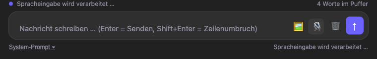

Im Screenshot ist der Fall direkt nach dem Start eines Diktats zu sehen: Die Statuszeile meldet, dass die Spracheingabe verarbeitet wird, im Puffer stehen die bereits erkannten vier Wörter – sie werden nicht verworfen, sondern nach Ablauf von `Retry-After` an denselben Endpunkt erneut geschickt.

#### Diktatbefehle

Standardmäßig sind diese Phrasen belegt und im Adminbereich erweiterbar:

| Kategorie | Befehle |
|---|---|
| Satzzeichen | „Punkt", „Komma", „Fragezeichen", „Ausrufezeichen", „Doppelpunkt", „Semikolon", „Gedankenstrich", „Bindestrich", „Prozent" |
| Klammern | „Klammer auf", „Klammer zu" |
| Anführung | „Anführungszeichen auf", „Anführungszeichen zu" |
| Umbruch | „Neue Zeile", „Neuer Absatz" |
| Löschen | „Lösche letztes Wort", „Lösche letzten Satz" |

Die Umwandlung übernimmt das Diktat-Modell anhand des konfigurierten Prompts; die Befehlsliste wird dabei aus den Einstellungen in den Prompt injiziert. Nur wenn das Modell nicht erreichbar ist, greift `speechDictationApplyCommands()` als deterministischer Regel-Fallback, damit kein erkannter Text verloren geht. Die Antwort enthält in diesem Fall `fallback: true` und einen Hinweis, der im Adminbereich als Warnung protokolliert wird.

#### Diktat-Modell

Das Diktat nutzt bewusst ein kleines Modell (Qwen3.5-2B Q4) statt eines großen Chat-Modells: Die Aufgabe ist eng umrissen, die Latenz soll niedrig bleiben und der Text verlässt den eigenen Server nicht. Das Modell läuft in SpeechInt, der Aufruf ist ein einzelner JSON-POST an `/v1/dictate/process`; LLMInt sendet Prompt, Befehlsliste, Kontext und Modellnamen mit, der Dienst ist damit zustandslos. Vier Punkte sind dafür entscheidend:

- **Reasoning ist hart abgeschaltet.** Der Dienst sendet neben `chat_template_kwargs.enable_thinking=false` zusätzlich llama.cpps natives `reasoning_budget: 0`. Ohne das zweite Feld ignorieren manche llama.cpp-Builds das Jinja-Flag, das Modell füllt den Token-Puffer mit einem Denkblock und die Antwort kommt leer zurück.
- **Der Prompt ist auf das Modell zugeschnitten.** Die Regeln stehen als kurze Stichpunkte, die Befehlsliste ist zu einer Zeile gruppiert und es gibt sechs Beispiele. Ausführlichere Varianten wurden gemessen und waren messbar schlechter.
- **Zeilenumbrüche macht nicht das Modell.** „Neue Zeile" und „Neuer Absatz" werden herausgeschnitten, bevor das Modell das Fragment sieht, und danach fest wieder eingesetzt. Das Modell verbraucht das Befehlswort zwar zuverlässig, schreibt an die Stelle aber ein Leerzeichen statt eines Umbruchs – deshalb listet der Prompt nur die übrigen Befehle und verlangt eine einzige Zeile.
- **Kontext und Satzgrenzen setzt die Pipeline deterministisch.** Der bereits geschriebene Text steht in der Systemnachricht – in der Nutzernachricht wiederholt das Modell ihn im Ergebnis. Weil jedes Segment eine eigene Completion ist, wird die klein diktierte Groß-/Kleinschreibung wiederhergestellt und ein abschließendes Satzzeichen entfernt, das nicht diktiert wurde.

Der Systemprompt und die Befehlsliste sind unter **Verwaltung → 🎙️ Spracherkennung / Diktat** editierbar (`speech_dictation_prompt`, `speech_dictation_commands`); beide werden bei jeder Anfrage an SpeechInt mitgeschickt. Ist das Feld `speech_dictation_prompt` leer, gilt der Standardprompt des Dienstes (`speechDictationDefaultPrompt()`).

#### Administration

Die Seite **Verwaltung → 🎙️ Spracherkennung / Diktat** (`admin/speech.php`) bündelt Aktivierung, aktiven Endpunkt, Sprache, die Puffer- und Segmentgrenzen sowie den Prompt und die Befehlsliste. Darunter lassen sich die SpeechInt-Endpunkte verwalten.

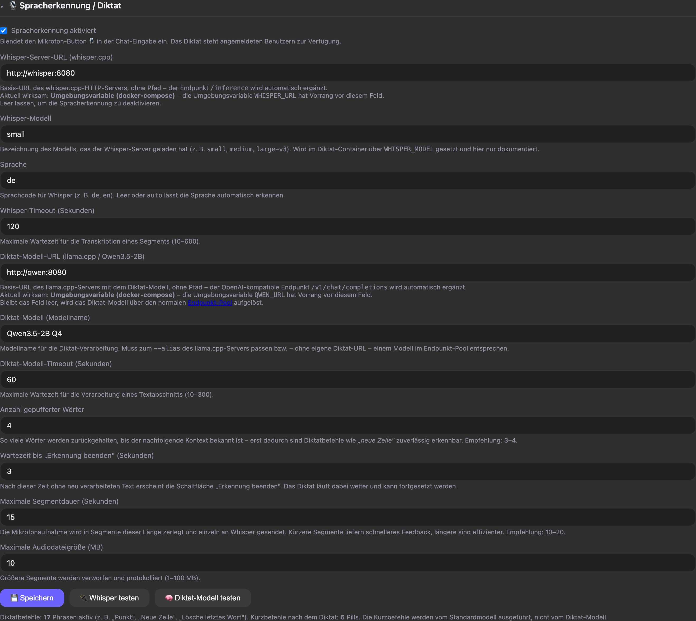

Über **Verbindung testen** lässt sich der Endpunkt direkt prüfen (`api/speech_health.php`); die Antwort zeigt Zustand, Modellnamen, Antwortzeit und die Dimensionierung des Hosts:


Ein Endpunkt besteht aus Adresse (`base_url`), optionalem Token und Timeout. Ein Endpunkt pro Anfrage: LLMInt verwaltet beliebig viele Endpunkte und nutzt den aktiven; die Reihenfolge in der Tabelle bestimmt die Vorschlagsliste. Der Token wird nur maskiert angezeigt und nie im Log ausgegeben.

| Einstellung | Bedeutung |
|---|---|
| `speech_dictation_enabled` | Diktat ein- oder ausschalten |
| `speech_dictation_endpoint_id` | ID des aktiven Endpunkts aus der Tabelle `speech_endpoints` (0 = noch keiner gewählt) |
| `speech_dictation_language` | Sprache für die Erkennung (`de`, `auto`, …) |
| `speech_dictation_buffer_words` | Wörter im Puffer, bevor ein Segment abgeschnitten wird (Empfehlung 3–4) |
| `speech_dictation_stop_timeout_seconds` | Stille bis zum automatischen Beenden der Erkennung |
| `speech_dictation_max_segment_seconds` | Maximale Länge eines Segments (Empfehlung 10–20) |
| `speech_dictation_max_audio_mb` | Obergrenze für die Dateigröße eines Segments |
| `speech_dictation_prompt` | Systemprompt des Diktat-Modells (leer = Standard) |
| `speech_dictation_commands`, `speech_dictation_pills` | Diktatbefehle und Schnellbefehl-Pillen als JSON |

Die Tabelle `speech_endpoints` speichert `alias`, `base_url`, `token`, `timeout`, `is_active` und `sort_order`. Die Umgebungsvariablen `SPEECHINT_URL`, `SPEECHINT_TOKEN` und `SPEECHINT_TIMEOUT` belegen den Standard-Endpunkt vor und haben – wie bei docconvert – Vorrang vor der Datenbank; die Karte zeigt unter „Aktuell wirksam" an, woher der Wert stammt. Zusätzlich veröffentlicht die Admin-Oberfläche die konfigurierten Endpunkte als Knoten unter der Gruppe „SpeechInt" in der Dashboard-Topologie.

#### SpeechInt-Dienst

Die rechenintensiven Bestandteile des Diktats – whisper.cpp mit dem `small`-Modell und llama.cpp mit Qwen3.5-2B Q4 – wurden in das Projekt [SpeechInt](https://github.com/dareinelt/SpeechInt) extrahiert. LLMInt startet sie nicht mehr selbst, sondern spricht einen oder mehrere SpeechInt-Endpunkte über HTTP an:

| Aufruf in LLMInt | Endpunkt in SpeechInt |
|---|---|
| Transkription eines Segments | `POST /v1/audio/transcriptions` (multipart) |
| Nachbearbeitung eines Fragments | `POST /v1/dictate/process` (JSON) |
| Verbindungstest | `GET /v1/ready` (ohne Token) bzw. `GET /v1/health` (mit Token) |
| Fähigkeiten, Vorgaben und Dimensionierung | `GET /v1/config` |

Der Dienst ist zustandslos: Prompt, Befehlsliste, Modellname und Temperatur kommen bei jeder Anfrage aus den LLMInt-Einstellungen mit. Die Authentifizierung erfolgt über den Header `X-Auth-Token`; ohne konfiguriertes Token sind die Routen offen.

**Mindestanforderung an den SpeechInt-Host:** mindestens **6 CPU-Kerne mit AVX2** und **16 GB RAM**. Die Modelle laufen ausschließlich auf der CPU; die Angabe ist die Dimensionierungsgrundlage für die Standardkonfiguration (`small` + Qwen3.5-2B Q4). Der Verbindungstest liest die tatsächliche Ausstattung über `/v1/config` aus und warnt im Adminbereich, wenn der Host darunter liegt (`host.meets_minimum`, `host.warnings`).

Ohne erreichbaren Endpunkt bleibt der Chat vollständig nutzbar; das Diktat ist dann deaktiviert bzw. meldet den Zustand in der Karte. Ein lokaler Testaufbau lässt sich mit dem Compose-Override `docker-compose.test.yml` starten, der nur `db` und `web` benötigt und auf einen externen SpeechInt-Host zeigt:

```bash
SPEECHINT_URL=http://speech-host:8080 docker compose -f docker-compose.yml -f docker-compose.test.yml up -d
```

### Bildgenerierung (ImageInt)

Bilder erzeugt der separate Dienst [ImageInt](https://github.com/dareinelt/ImageInt): ein Prompt-Enhancer und ein Renderer auf Basis von **Qwen-Image-2.1**, hinter einem gemeinsamen HTTP-Service. LLMInt startet keine Bildmodelle selbst, sondern präsentiert dem laufenden Text-LLM das Tool `generate_image` und schickt den Bildwunsch per HTTP an einen ImageInt-Endpunkt. Ist kein Endpunkt konfiguriert oder erreichbar, bleibt der Chat vollständig nutzbar – nur das Tool fehlt dann im Angebot.

ImageInt ersetzt die früheren Integrationen **AUTOMATIC1111** und **ComfyUI**. Das Tool heißt weiterhin `generate_image`; `generate_image_comfy` ist entfallen. Die Admin-Karten der alten Integrationen sind nur noch ausgeblendet, ihre Tabellen und Einstellungen bleiben erhalten.

#### Ablauf

1. **Erkennung:** Der Systemprompt enthält die Auslöse-Formulierungen aus `image_prompt_trigger_text` (Standard: „Generiere ein Bild …", „Erstelle eine Grafik …", „Zeige mir ein Bild von …"). Genauso wichtig ist die Gegenregel aus `image_prompt_anti_trigger_text`: eine Frage *über* Bilder („Wie funktioniert Bildgenerierung?") darf das Tool nicht auslösen. Beide Texte sind in der Admin-Karte editierbar, damit sie ohne Deployment erweitert werden können.
2. **Aufruf:** `api/chat.php` schickt `POST /v1/images/generations` mit `prompt`, optional `negative_prompt` und `size` (z. B. `16:9`, `1:1`, `4:3`) – und immer mit `wait: false`. Der Dienst antwortet sofort mit **202** und einer `job_id`; ein PHP-Request bleibt damit nicht minutenlang offen.
3. **Warten:** LLMInt pollt `status_url`, solange der Auftrag `queued` oder `running` ist, und zeigt den Fortschritt anhand von `stage` (`queued` → `enhancing` → `rendering` → `done`). Nur ein kurzes Fenster (`imageIntInlineWait()`, höchstens 25 s) wird direkt im Chat-Request abgewartet; danach gibt der Request den Auftrag an den Browser zurück, der über `api/image_status.php` weiterpollt. So bleibt der Chat schnell und kein Browser oder Reverse-Proxy läuft in einen Timeout, während ImageInt weiterrechnet.
4. **Ergebnis:** Ist der Auftrag `done`, lädt LLMInt das PNG über `image_url` herunter und legt es in `image_output/` ab. Im Chat erscheint es als Markdown-Bild.

Die `image_url` aus dem Job-Dokument zeigt auf den ImageInt-Host, den ein Browser in der Regel nicht erreichen kann. LLMInt spiegelt das PNG deshalb lokal und verwendet für Chat und Mail die lokale Adresse.

#### Lade-Feedback

Nach einem Neustart lädt ImageInt erst den Enhancer und den Renderer. Solange antwortet `/v1/ready` und `POST /v1/images/generations` mit **503** und `transient: true` samt deutschem Hinweistext und `Retry-After`. LLMInt behandelt das **nicht** als Fehler: Der Chat zeigt eine Wartemeldung und fragt nach der von `Retry-After` vorgegebenen Zeit erneut an. Erst wenn der Host die Hardwareanforderung nicht erfüllt (`503 host_unsupported`, AVX2 fehlt), meldet der Verbindungstest einen echten Fehler – Warten hilft dort nicht.

Dasselbe gilt für ein **beschäftigtes** ImageInt: Solange ein Bild gerendert wird, ist der Modellserver belegt und der Dienst lehnt neue Aufträge mit **503** und `error: "image_unavailable"` ab. Auch das ist kein Fehler, sondern eine Wartezeit – der Chat meldet „ImageInt rechnet gerade an einem anderen Bild" mit einem erneuten Versuch in einigen Minuten. Ein laufender Auftrag wird bei einem solchen `503` weiter verfolgt, nicht abgebrochen; das Poll-Intervall wächst dabei mit dem Alter des Auftrags (15 → 30 → 60 → 120 s). Timeouts bei der Statusabfrage werden genauso behandelt: Der Chat pollt weiter, solange der Auftrag nicht `error` oder `expired` meldet.

#### Zustimmung und Benachrichtigungsmail

Eine CPU-Generierung dauert Minuten. Sobald der Auftrag länger als das Inline-Fenster läuft, blendet der Chat die Zustimmungsfrage aus `image_notify_consent_text` ein:

> Das Generieren dieser Antwort kann einige Zeit in Anspruch nehmen. Möchten Sie per E-Mail über die Fertigstellung benachrichtigt werden?

Darunter stehen „Ja, per E-Mail benachrichtigen" und „Nein, ich warte hier". Ein „Ja" legt über `api/image_notify.php` genau eine Zeile in `image_notifications` an; ein zweiter Klick oder ein Neuladen erzeugt dank `UNIQUE KEY uniq_job_user` keine zweite Mail. Ein „Nein" erzeugt keine Zeile und keine Mail.

Kann keine Mail angeboten werden, sagt der Chat das, statt die Frage zu verschweigen: fehlt im Profil eine E-Mail-Adresse, erscheint der Hinweis „Für eine Benachrichtigung per E-Mail fehlt eine Adresse in Deinem Profil …"; ist die Funktion im Adminbereich abgeschaltet, der Hinweis „Benachrichtigungen per E-Mail sind derzeit nicht aktiviert …". Die Frage selbst liegt am gespeicherten Auftrag (`image_job.notify`), übersteht damit ein Neuladen der Sitzung und wird nicht erneut gestellt, sobald eine Zustimmung hinterlegt ist.

Die Mail verschickt **nicht** der Browser, sondern `api/image_notify_worker.php`:

```bash
* * * * * php /var/www/html/api/image_notify_worker.php --limit=20 >/dev/null
```

Der Worker fragt den Auftragsstatus ab und schickt die Mail, sobald das Bild fertig ist – auch bei geschlossenem Browser. Er läuft nur einmal gleichzeitig (Dateisperre), damit zwei überlappende Cron-Läufe nicht doppelt zustellen. ImageInt bewahrt fertige Bilder nur `IMAGEINT_JOB_RETENTION_SECONDS` lang auf (Standard 24 h); ist der Auftrag danach weg, antwortet der Dienst mit `404 not_found` und die Zeile wird als `expired` markiert, statt einen toten Link zu verschicken.

#### Platzhalter

Beide Texte – Zustimmungsfrage und Mail – sind vollständig templatisiert. Alle Platzhalter werden über `str_replace()` aufgelöst; unbekannte bleiben unverändert stehen.

| Platzhalter | Inhalt |
|---|---|
| `{sitename}` | Absendername (`smtp_from_name`) |
| `{username}` | Benutzername des Empfängers |
| `{email}` | hinterlegte E-Mail-Adresse des Empfängers |
| `{prompt}` | der Bildwunsch |
| `{chat_url}` | Deep-Link in den Chat |
| `{image_url}` | direkte Adresse des fertigen Bildes |
| `{duration}` | Dauer der Generierung, lesbar formatiert |
| `{width}`, `{height}` | Abmessungen des fertigen Bildes |
| `{job_id}` | Auftragsnummer bei ImageInt |

Der Deep-Link hat die Form `index.php?session=<session_id>&job=<job_id>`. `index.php` übernimmt die Sitzung aus der URL **nur**, wenn sie dem angemeldeten Benutzer gehört; ein Link aus einer fremden Mail öffnet keine fremde Sitzung. Danach wird zum Bild gescrollt, das Ergebnis kurz hervorgehoben und die Parameter werden per `history.replaceState()` aus der Adresszeile entfernt.

#### Administration

Die Seite **Verwaltung → 🖼️ Bildgenerierung** (`admin/image.php`) bündelt Aktivierung, aktiven Endpunkt, die Zustimmungs- und Mailtexte, die Basis-URL für die Links sowie Auslöse- und Gegenregel. Darunter lassen sich die Image-Endpunkte verwalten; der Verbindungstest fragt `/v1/ready` ab und zeigt bei Erfolg zusätzlich die beiden Modellserver und die Dimensionierung des Hosts.

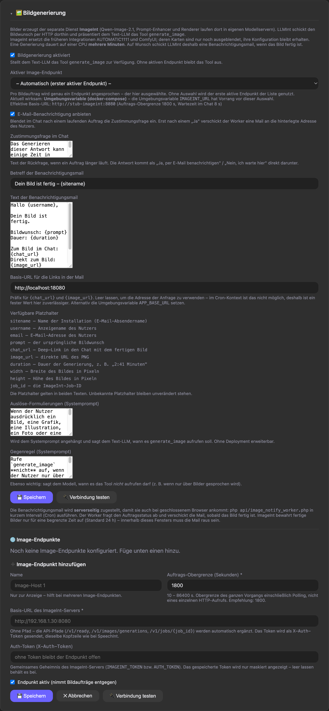

Die Tabelle `image_endpoints` speichert `alias`, `base_url`, `token`, `timeout`, `is_active` und `sort_order`. Die Umgebungsvariablen `IMAGEINT_URL`, `IMAGEINT_TOKEN` und `IMAGEINT_TIMEOUT` belegen den Standard-Endpunkt vor und haben – wie bei SpeechInt – Vorrang vor der Datenbank; die Karte zeigt unter „Aktuell wirksam" an, woher der Wert stammt. Das Token wird als `X-Auth-Token` gesendet und in der Oberfläche nur maskiert angezeigt.

| Einstellungsschlüssel | Bedeutung |
|---|---|
| `image_generation_enabled` | stellt das Tool `generate_image` bereit |
| `image_endpoint_id` | fest gewählter Endpunkt (`0` = erster aktiver) |
| `image_notify_enabled` | blendet die Zustimmungsfrage ein |
| `image_notify_consent_text` | Text der Rückfrage |
| `image_notify_email_subject`, `image_notify_email_body` | Betreff und Text der Mail |
| `image_notify_base_url` | Präfix für `{chat_url}` und `{image_url}` |
| `image_prompt_trigger_text`, `image_prompt_anti_trigger_text` | Systemprompt-Regeln |

#### ImageInt-Dienst

Die rechenintensiven Bestandteile wurden in das Projekt [ImageInt](https://github.com/dareinelt/ImageInt) extrahiert. LLMInt spricht einen oder mehrere ImageInt-Endpunkte über HTTP an:

| Aufruf in LLMInt | Endpunkt in ImageInt |
|---|---|
| Verbindungstest und Lade-Feedback | `GET /v1/ready`, `GET /v1/health`, `GET /v1/models` |
| Auftrag starten | `POST /v1/images/generations` (mit `wait: false`) |
| Auftrag verfolgen | `GET /v1/jobs/{job_id}` |
| Bild abholen | `GET /v1/jobs/{job_id}/image` bzw. `GET /v1/images/{job_id}` |

**Mindestanforderung an den ImageInt-Host:** eine CPU mit **AVX2** (der Renderer nutzt `diffusers`/`transformers` und läuft nur auf der CPU). Der Verbindungstest liest die tatsächliche Ausstattung über `/v1/health` aus und meldet sie im Adminbereich.

Ohne erreichbaren Endpunkt bleibt der Chat vollständig nutzbar; das Tool fehlt dann. Ein lokaler Testaufbau lässt sich mit dem Compose-Override `docker-compose.test.yml` starten, der nur `db` und `web` benötigt und auf einen externen ImageInt-Host zeigt:

```bash
IMAGEINT_URL=http://image-host:8080 docker compose -f docker-compose.yml -f docker-compose.test.yml up -d
```

## API

### Chat und Sitzungen

| Pfad | Methode | Zweck |
|---|---|---|
| `api/chat.php` | POST | Chat-Request einschließlich Routing und Tools |
| `api/models.php` | GET | Modelle eines Endpunkts |
| `api/chat_sessions.php?action=list` | GET | Sitzungen des aktuellen Benutzers |
| `api/chat_sessions.php?action=load` | GET | Sitzung laden |
| `api/chat_sessions.php?action=delete` | POST/GET | Sitzung löschen |

### OpenAI-kompatible Endpunkte

| Pfad | Methode | Zweck |
|---|---|---|
| `api/openai/v1/models` | GET | Key-Modell bzw. Gast-Standardmodell (ohne Key das Standardmodell) |
| `api/openai/v1/chat/completions` | POST | Chat Completions ohne Tools |
| `api/openai-tools/v1/models` | GET | Key-Modell bzw. Gast-Standardmodell (ohne Key das Standardmodell) |
| `api/openai-tools/v1/chat/completions` | POST | Chat Completions mit Web-, RAG- und Bild-Tools |

LLMInt arbeitet für externe Applikationen als Reverse-Proxy vor den LLM-Endpunkten. Per API zugreifende Applikationen verhalten sich wie ein **nicht angemeldeter Benutzer**:

- Es wird keine PHP-Sitzung verwendet; ein mitgesendetes Session-Cookie wird ignoriert. Bildanhänge, Intelligenzgruppen (`@@…`) und benutzerbezogene Dokumente stehen daher – wie für Gäste – nicht zur Verfügung.
- Das Feld `model` der Anfrage wird ignoriert. Jede Anfrage startet mit dem am API-Key hinterlegten Modell (siehe Admin-Bereich → **Verwaltung → 🗝️ API-Keys**); ist dort keines gesetzt oder wird die Anfrage ohne gültigen Key gestellt, gilt das Gast-Standardmodell (Einstellung `default_model`). Ein am Key hinterlegtes Modell wird nur verwendet, solange es von einem aktiven Endpunkt angeboten wird – sonst greift das Standardmodell. Danach greifen Prompt Security, Entscheidungsmodell/Routing, Balancer, Fallback und Warteschlange genau wie bei einem direkten Zugriff. Reasoning lässt sich per `!!`-Präfix oder `reasoning_effort` aktivieren.
- Ein API-Key im Header `Authorization: Bearer <key>` ist optional. Unbekannte, deaktivierte oder abgelaufene Keys (z. B. Platzhalter, die manche Clients zwingend senden) werden wie ein Zugriff ohne Key behandelt; ein gültiger Key dient der Zuordnung im Log und kann optional ein festes Modell festlegen, nicht der Anmeldung als Key-Besitzer.
- Alle Log-Einträge einer API-Anfrage tragen das Präfix `[API]` bzw. `[API · Key „Name“]` und werden im Log-Viewer als Badge hervorgehoben; ein Eintrag „Zugriff über OpenAI-kompatible API …" protokolliert Client-IP, Tool-Modus, angefordertes und verwendetes Modell sowie die Herkunft des Modells (API-Key-Modell oder Standardmodell).
- Jede Anfrage an `chat/completions` zählt für den zugehörigen Key mit (Aufrufe heute, Aufrufe gesamt, zuletzt genutztes Modell); ohne gültigen Key landen die Aufrufe im Sammeleintrag „ohne Key". Beides erscheint als Wolke am Knoten **API** der Dashboard-Topologie. Das Auflisten der Modelle (`/v1/models`) wird nicht gezählt.

Die Basis-URLs zum Kopieren zeigt der Admin-Bereich unter **Verwaltung → 🔌 OpenAI-API**, die Keys verwaltet die Seite **Verwaltung → 🗝️ API-Keys**. API-Keys werden als Hash gespeichert; beim Erstellen lässt sich das zu verwendende Modell aus den Modellen der aktiven Endpunkte auswählen.

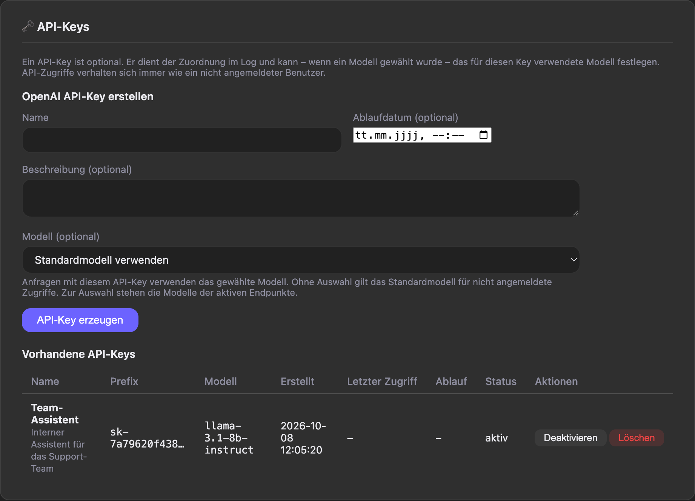

Im Screenshot zeigt das Formular „OpenAI API-Key erstellen" in der Dashboard-Karte **🗝️ API-Keys** das Dropdown **Modell (optional)** – zur Auswahl stehen die Standard-Modelle aller aktiven Endpunkte; die Option „Standardmodell verwenden" lässt den Key ohne feste Modellbindung. Darunter listet „Vorhandene API-Keys" in der Spalte **Modell** das fest gebundene Modell bzw. den Hinweis „Standardmodell".

```python
from openai import OpenAI

client = OpenAI(
    base_url="https://server.example/api/openai/v1",
    api_key="sk-...",  # optional; ohne Key einen beliebigen Platzhalter angeben
)

response = client.chat.completions.create(
    model="khwf-ki",  # wird ignoriert, es gilt das Modell des API-Keys bzw. das Gast-Standardmodell
    messages=[{"role": "user", "content": "Hallo"}],
)
print(response.choices[0].message.content)
```

### Weitere Endpunkte

| Bereich | Endpunkte |
|---|---|
| Dokumente | `api/upload_document.php`, `api/document_status.php`, `api/document_retention.php`, `api/document_delete.php`, `api/rebuild_embeddings.php` |
| Wissensdatenbank (Admin) | `api/vector_import.php` (docvecwizard-Export importieren / Archive auflisten), `api/test_vector_store.php` (Verbindungstest Remote-API oder Milvus) |
| Bildgenerierung | `api/image_status.php` (Status und PNG eines Auftrags), `api/image_notify.php` (Zustimmung zur Benachrichtigungsmail), `api/image_health.php` (Verbindungstest eines Endpunkts), `api/image_notify_worker.php` (Cron/CLI-Versand der Benachrichtigungsmails) |
| Integrationen | `api/test_searxng.php`, `api/test_ldap.php`, `api/test_smtp.php` |
| Benutzer und Status | `api/verify_email.php`, `api/reset_password.php`, `api/admin_user_action.php`, `api/heartbeat.php` |
| Spracherkennung und Diktat | `api/speech_config.php` (Konfiguration und CSRF für die Oberfläche), `api/speech_transcribe.php` (Audiodatei → Rohtext), `api/speech_process.php` (Fragment → bereinigter Text), `api/speech_health.php` (Verbindungstest eines Endpunkts, optional `url`/`token`) |
| Administration | `admin/load_stats.php`, `admin/refresh_sys_stats.php`, `admin/usage_stats.php` (Nutzungsstatistik, Parameter `days`) |

### Anfrageformat von `api/chat.php`

Der Endpunkt erwartet einen JSON-Body und antwortet mit JSON oder – bei `"stream": true` – mit `text/event-stream`.

| Feld | Bedeutung |
|---|---|
| `model`, `messages` | Modellname und Nachrichtenverlauf im OpenAI-Format; Bildanhänge als `image_url`-Teile |
| `stream`, `temperature`, `max_tokens`, `top_p`, `stop`, `stream_options` | übliche Generierungsparameter |
| `session_id` | speichert den Verlauf in `conversation_sessions` |
| `intelligence_group` | Intelligenzgruppe für die aktuelle Sitzung |
| `force_search_query` | erzwingt eine Websuche vor dem Modellaufruf |
| `intelligence_upgrade_accepted`, `action` | Annahme beziehungsweise Ablehnung (`decline_intelligence_upgrade`) des Upgrade-Angebots |

Beim Streaming werden zusätzlich zu den OpenAI-Chunks folgende Frames gesendet: `{"status":"queued", ...}` während der Wartezeit auf einen freien Slot, `{"error": "..."}` bei Fehlern, `{"type":"intelligence_upgrade", ...}` für das Upgrade-Angebot, `{"type":"response_details", ...}` mit Endpunkt, Dauer, Quellen und Kontextauslastung sowie abschließend `[DONE]`. Über die OpenAI-kompatiblen Pfade entfallen die LLMInt-spezifischen Frames.

### Tools des Chat-Modells

| Tool | Voraussetzung | Parameter |
|---|---|---|
| `search_web` | konfiguriertes SearXNG | `query` |
| `web_fetch` | konfiguriertes SearXNG | `url`, optional `max_chars` (500–20000, Standard 6000) |
| `generate_image` | aktiver ImageInt-Endpunkt | `prompt`, optional `negative_prompt`, `size` (z. B. `16:9`, `1:1`, `4:3`) |
| `query_documents` | vorhandene Dokument-Uploads | `query` |

Tools werden nur an Endpunkte gesendet, die als Tool-Calling-fähig markiert sind.

`generate_image` ist das einzige Bild-Tool: die früheren Integrationen AUTOMATIC1111 (`generate_image` mit `width`/`height`) und ComfyUI (`generate_image_comfy`) sind entfallen. Die Seitenverhältnisse wählt ImageInt selbst über seinen Prompt-Enhancer; `size` bleibt als Notausgang. Da eine CPU-Generierung mehrere Minuten dauert, kann sich der Nutzer per E-Mail benachrichtigen lassen; die Mail schickt `api/image_notify_worker.php`, damit sie auch bei geschlossenem Browser ankommt.

## Datenmodell

Das Schema wird idempotent angelegt: `setup.php` führt die Erstinstallation inklusive der Tabelle `users` aus, `db.php` stellt bei jedem Start über `ensureRuntimeSchema()` alle Laufzeittabellen und Migrationen sicher.

| Gruppe | Tabellen |
|---|---|
| Konfiguration und Konten | `settings`, `users`, `api_keys` (optionales Modell je Key, dazu die Aufrufzähler für die Topologie), `api_anonymous_usage` (Aufrufe ohne gültigen Key) |
| LLM-Betrieb | `endpoints`, `tasks`, `endpoint_sys_stats`, `app_logs` |
| Chat und Routing | `conversation_sessions`, `routing_categories`, `routing_rules`, `search_logs` |
| Dokumente und Embeddings | `document_uploads`, `document_chunks`, `embedding_endpoints`, `embedding_cache`, `embedding_logs` |
| Zentrale Wissensdatenbank | `vector_documents`, `vector_chunks`, `vector_imports`, `vector_query_logs` (Vektoren selbst liegen in Milvus) |
| Bildgenerierung | `image_endpoints`, `image_notifications`; die Tabellen der früheren Integrationen (`sd_endpoints`, `sd_tasks`, `comfy_endpoints`, `comfy_tasks`) bleiben erhalten, werden aber nicht mehr angesprochen |
| Monitoring | `active_clients`, `client_count_log`, `client_count_daily`, `user_login_log` |
| Sicherheit | `prompt_security_rules`, `prompt_security_logs` |

## Betrieb hinter lanpa

LLMInt lässt sich hinter den `auth`-Container von [lanpa](https://github.com/dareinelt/lanpa) stellen und ist dann unter `https://<lanpa-host>/ki/` erreichbar. Vorteile:

- **Zentrale Zertifikatverwaltung:** HTTPS terminiert der `auth`-Container mit dem unter lanpa → Admin → **Zertifikate (HTTPS)** verwalteten Zertifikat; LLMInt braucht weder eigenes Zertifikat noch eigenen DNS-Namen.
- **Windows-SSO ohne eigene Keytab:** Die Kerberos/NTLM-Anmeldung übernimmt der domänenverbundene `auth`-Container. Er verlangt sie nur für `/ki/sso.php` und reicht den erkannten Benutzer im Header `X-Remote-User` weiter.

Ablauf der Anmeldung: Beim ersten Aufruf je Sitzung leitet `index.php` (bzw. `admin/login.php`) einmalig auf `sso.php`. Mit Domänenanmeldung wird der Benutzer wie bisher über LDAP-SSO angelegt bzw. angemeldet; ohne liefert lanpa `sso_fallback.php`, die zurück zur Zielseite führt (Gastzugang bzw. Anmeldeformular). Nach dem Abmelden erfolgt keine automatische Neuanmeldung; über **🪟 Mit Windows-Anmeldung anmelden** auf den Anmeldeseiten lässt sie sich erneut auslösen. Benutzer weiterer Identitätsquellen von lanpa (`X-Remote-Source`) werden nicht übernommen.

**Einrichtung auf demselben Docker-Host:**

1. Gemeinsames Netz einmalig anlegen:

   ```bash
   docker network create --subnet 172.30.251.0/24 llmint-proxy
   ```

2. LLMInt mit dem Override starten (hängt `web` mit dem Alias `llmint-web` an das Netz und setzt `TRUSTED_PROXIES=172.30.251.0/24` sowie `PROXY_SSO_HEADER=X-Remote-User`). Den direkten Port auf localhost beschränken, damit TLS nicht umgangen wird:

   ```bash
   # .env
   HTTP_PORT=127.0.0.1:8080
   COMPOSE_FILE=docker-compose.yml:docker-compose.lanpa.yml

   docker compose up -d
   ```

3. In lanpa `LLMINT_ENABLED=true` und `LLMINT_UPSTREAM=http://llmint-web` setzen (optional `LLMINT_PATH`, Standard `/ki`) und `docker-compose.llmint.yml` in `COMPOSE_FILE` aufnehmen, damit der `auth`-Container an `llmint-proxy` hängt (Details in `docs/llmint.md` von lanpa).
4. Für SSO in LLMInt unter **Einstellungen → LDAP** LDAP aktivieren und **Windows-SSO** einschalten.
5. Optional in lanpa eine Kachel auf `/ki/` anlegen.

**LLMInt auf einem anderen Host:** `LLMINT_UPSTREAM=http://<llmint-host>:8080` in lanpa, in LLMInt `TRUSTED_PROXIES=<IP des lanpa-Hosts>` und `PROXY_SSO_HEADER=X-Remote-User`; den Port per Firewall nur für den lanpa-Host freigeben.

| Variable | Bedeutung |
|---|---|
| `TRUSTED_PROXIES` | IP-Adressen, CIDR-Bereiche oder Hostnamen der Reverse-Proxys (kommagetrennt). Nur von dort werden `X-Forwarded-For/-Proto/-Host/-Prefix` und der SSO-Header übernommen, von allen anderen Absendern verworfen. Leer = bisheriges Verhalten. |
| `PROXY_SSO_HEADER` | Header mit dem vom Proxy angemeldeten Benutzer (lanpa: `X-Remote-User`); wird als `REMOTE_USER` an die vorhandene LDAP-SSO-Logik übergeben. Leer = aus. |
| `LLMINT_PROXY_NETWORK` | Name des gemeinsamen Docker-Netzes in `docker-compose.lanpa.yml` (Standard `llmint-proxy`). |

Technik: `lib/reverse_proxy.php` wird im Container per `auto_prepend_file` (`docker/php.ini`) vor jedem Skript geladen und zusätzlich von `db.php` eingebunden. Es ermittelt die Client-IP aus `X-Forwarded-For` (von rechts, vertrauenswürdige Hops übersprungen), setzt `HTTPS` und das `secure`-Flag des Sitzungscookies und bildet absolute Links (E-Mail-Verifikation, Passwort-Reset, OpenAI-Basis-URL) mit dem Präfix aus `X-Forwarded-Prefix`. Alle übrigen Links der Oberfläche sind relativ und funktionieren unter `/ki/` ohne Anpassung; den Cookie-Pfad schreibt lanpa auf `/ki/` um. Bei klassischer Installation `auto_prepend_file` auf `lib/reverse_proxy.php` setzen, damit das `secure`-Flag greift.

Hinweis: LLMInt läuft unter `/ki/` im selben Origin wie lanpa. Beide Anwendungen verwenden unterschiedliche, `HttpOnly`-gesetzte Sitzungscookies (`PHPSESSID` bzw. `INTRANETSESSID`); generierte Bilder in `sd_output/` und `image_output/` werden nur als PNG mit `X-Content-Type-Options: nosniff` ausgeliefert, Dokument-Uploads gar nicht.

## Betrieb und Sicherheit

- `setup.php` nach erfolgreicher Einrichtung nicht öffentlich erreichbar lassen.
- Alle Standardpasswörter in `.env` und das initiale Admin-Passwort vor dem produktiven Einsatz ändern.
- Den Admin-Bereich nur über vertrauenswürdige Netze zugänglich machen.
- API-Keys, LDAP-Bind-Passwörter, SMTP-Zugangsdaten und Kerberos-Dateien nicht in das Repository einchecken.
- Speicherbedarf von `doc_uploads`, `sd_output` und `image_output` sowie die Log-Aufbewahrung regelmäßig prüfen.
- Nach einem Wechsel des Embedding-Modells fehlende Embeddings über den Admin-Bereich neu berechnen und bei Bedarf den Embedding-Cache leeren.

## Troubleshooting

<details>
<summary><strong>Häufige Probleme und ihre Prüfpunkte</strong></summary>

| Problem | Prüfen |
|---|---|
| Datenbankfehler oder Setup-Hinweis | DB-Umgebungsvariablen, Datenbankrechte und `php setup.php` |
| Keine Modelle verfügbar | Endpunkt-URL, Netzwerkpfad, Modellgruppe und Timeout |
| Endpunkt erhält keine Anfragen | Aktivierung, Modellgruppe, freie Slots, Circuit-Status und Cooldown prüfen |
| Unerwartetes Fallback-Modell | `balancer_fallback_chains` und Routing-Regeln unter **Balancer & Routing** prüfen |
| Dokument-Upload schlägt fehl | Upload-Recht, Dateityp/-größe, Schreibrechte und bei PDFs `pdftotext` |
| Keine Embeddings | `embedding_enabled`, aktiver Embedding-Endpunkt, Endpunkt-URL und Admin-Statistik |
| LDAP-Login oder SMTP-Versand fehlschlägt | Konfiguration und die jeweiligen Testendpunkte |
| Hinter lanpa: falsche Client-IP, Links ohne `/ki/` oder kein SSO | `TRUSTED_PROXIES` muss die Adresse des `auth`-Containers abdecken, `PROXY_SSO_HEADER=X-Remote-User`, LDAP und Windows-SSO in den Einstellungen aktiv |
| Keine SSH-Metriken | PHP-Erweiterung `ssh2`, Endpunktzugangsdaten und `lm-sensors` auf dem Zielhost |
| Diktat-Button fehlt | `speech_dictation_enabled`, Adminbereich → **🎙️ Spracherkennung / Diktat**; der Button erscheint nur bei aktivierter Erkennung |
| Diktat liefert Rohtext ohne Befehlsauswertung | Verbindungstest in der Admin-Karte: ist das Diktat-Modell im SpeechInt-Dienst nicht erreichbar, greift der Regel-Fallback (Antwort mit `fallback: true`); Endpunkt, Token und Timeout prüfen |
| Diktat meldet dauerhaft „Modelle werden noch geladen" | Der SpeechInt-Dienst lädt beim ersten Start die Modelle; Fortschritt mit `docker compose logs -f whisper` bzw. `-f llm` auf dem SpeechInt-Host prüfen |
| SpeechInt-Endpunkt meldet `whisper_unreachable` oder `model_unreachable` | Im SpeechInt-Container läuft der jeweilige Modellprozess nicht; Logs des Dienstes prüfen |
| SpeechInt-Host wird als zu klein gemeldet | `host.warnings` im Verbindungstest beachten – Mindestanforderung sind 6 CPU-Kerne mit AVX2 und 16 GB RAM |
| Erkennung schneidet mitten im Satz ab | `speech_dictation_buffer_words` und `speech_dictation_stop_timeout_seconds` erhöhen; `max_segment_seconds` prüfen |

</details>

## Entwicklung und Tests

- Voraussetzung ist lediglich PHP mit den genannten Erweiterungen sowie eine Datenbank; Composer, npm oder ein Build-Schritt werden nicht benötigt.
- Änderungen am Schema gehören nach `ensureRuntimeSchema()` in `db.php`, damit bestehende Installationen automatisch migrieren; die Erstinstallation wird in `setup.php` ergänzt.
- Neue Einstellungen erhalten ein Formular mit `action`-Wert auf der zuständigen Adminseite `admin/<seite>.php` (POST-Zweig in `admin/partials/actions.php`) und werden über `getSetting()` beziehungsweise `setSetting()` verwendet.
- Neue HTTP-Endpunkte werden als eigene Datei unter `api/` angelegt, binden `db.php` ein und prüfen Sitzung, Rolle und CSRF-Token wie die bestehenden Endpunkte.
- Neue Chat-Tools benötigen eine Definition, eine Verfügbarkeitsprüfung und einen Zweig in der Tool-Schleife von `api/chat.php`.
- Datenbankzugriffe erfolgen ausschließlich über vorbereitete PDO-Statements, Ausgaben werden mit `htmlspecialchars()` maskiert, Meldungen sind auf Deutsch, Protokollierung erfolgt über `writeLog()`.
- Vor dem Commit sollten geänderte Dateien mit `php -l` geprüft werden.

Die Übersetzungsschicht der Topologie (`lib/topology.php`) und der Canvas-Renderer (`assets/js/flow-topology.js`) sind durch abhängigkeitsfreie Tests abgesichert – kein Composer, kein PHPUnit, kein npm-Paket:

```sh
./tests/run.sh        # PHP- und JavaScript-Tests
./tests/run.sh php    # nur tests/php/test_*.php
./tests/run.sh js     # nur tests/js/*.test.js
```

Ohne lokale PHP-/Node-Installation laufen dieselben Tests per Docker; die genauen Befehle und der Aufbau der Suiten stehen in [`tests/README.md`](tests/README.md). Der Workflow `.github/workflows/tests.yml` führt sie bei jedem Pull Request aus.

## Lizenz

MIT
